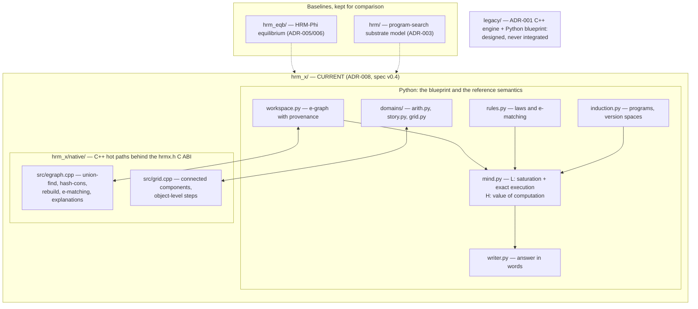

# 🧠 HRM-X Knowledge Dashboard

> [!IMPORTANT] What this vault describes today
> The live model is **HRM-X v0.4 — operator inference over structured situations** (spec v0.4, [[ADR-008 Operator Inference over Structured Situations]]), in `hrm_x/`. The notes under `01`–`05` were written for the ADR-001 "Python blueprint + C++ engine" design, which **was never built**; ADR-003 moved it to `legacy/`. They are kept as design history, not as a description of the code. For the code that actually exists, use [[Code Map]].

Welcome to the internal engineering knowledge base for **HRM-X**: a reasoner that infers
*operators* (small programs) from evidence and applies them exactly to *structured
situations*, checking each answer in an independent representation.

---

## 🧬 Three generations, all present in the repo

| Generation | Path | Role | Standing |
| :--- | :--- | :--- | :--- |
| `hrm_x/` | ADR-008, spec v0.4 | **Current model.** E-graph workspace with provenance, inferred programs, laws, H as a value-of-computation controller. C++ hot paths in `hrm_x/native/`. | live |
| `hrm_eqb/` | ADR-005, ADR-006 | HRM-Phi equilibrium baseline: neural H/L trained on algebra. It measured no arithmetic (ADR-006), which is why it was replaced. | baseline |
| `hrm/` | ADR-003 | The first unified cognitive model: program search over a phasor substrate. | baseline |
| `legacy/` | ADR-001, ADR-002 | The C++ engine plus Python blueprint design. **Never integrated with the live model.** | historical |

---

## ⚡ Current architecture

Exact `Fraction` arithmetic stays in Python on purpose (ADR-008): arbitrary precision is the
guarantee, so the C++ accelerates only the e-graph and the grid, and parity with the Python
reference is tested differentially (`tests/test_x_native.py`).

---

## 📊 Quick metrics (measured, `experiments/results/*.json`)

- **Tests**: `python -m pytest` → **436 passed, 1 skipped**.
- **Exact extrapolation (E1)**: **1.000** on every split — in-range, 10²–10⁴ integers, large decimals, 10×3.1.
- **Composition (E2)**: **1.000** at depths 1–3.
- **Native backend**: results identical to Python; grid **3.79×**, arithmetic **1.47×**.
- **v0.5 vs v0.4, one mind (E13)**: in-language **13/15 correct at 593 ops** against 7/15 at 4,265 ops (7.2x cheaper); out-of-language **5 confidently wrong of 6**, where v0.4 had 0 wrong and 4 abstentions. See [[ADR-010 Structural Operator Inference]].
- **Experiment result files**: **12** in `experiments/results/` (`x_v05.json` added 2026-09-29).

---

## 🧭 Navigation & Maps of Content (MOCs)

| Knowledge Hub | Focus Area | Direct Link |
| :--- | :--- | :--- |
| **Master Index** | Complete vault graph and topic index | [[Master MOC]] |
| **Code Map** | Which document is implemented by which file | [[Code Map]] |
| **Current spec** | HRM-X v0.4, operator inference (normative) | [[HRM-X Specification v0.4 - Operator Inference over Structured Situations]] |
| **Decision Records** | ADRs, including the ones this design replaced | [[ADR-008 Operator Inference over Structured Situations]] |
| **Python subsystems** | One note per module of `hrm_x/`, `hrm_eqb/`, `hrm/` | [[HRM-X Workspace & Rules]] |
| **The only C++** | E-graph and grid kernels behind `hrmx.h` | [[HRM-X Native Backend]] |
| **Build & Toolchain** | `scripts/build_native.ps1`, `python -m pytest` | [[Build & Toolchain Guide]] |

### Historical — the ADR-001 design that was never built

| Knowledge Hub | Focus Area | Direct Link |
| :--- | :--- | :--- |
| **System Philosophy** | Why Python blueprint + C++ engine | [[Hybrid System Philosophy]] |
| **HRM+LLM Fusion** | Research brief, architectures A–E | [[HRM+LLM Fusion Architecture]] |
| **Tensor Data Flow** | Shape mappings $(B, T) \to (B, D) \to (B, V)$ | [[Tensor Flow & Data Pipelines]] |
| **C++ Engine & Kernels** | Arena, tensor views, thread pool, kernels | [[Engine Architecture & Memory Model]] |
| **Python Blueprint** | Declarative layout API, graph mutators, configs | [[Model Blueprint & Graph Layout]] |
| **C-ABI & Interop** | The `hrm_c_api.h` that was never written | [[C-ABI & Interop Specification]] |
