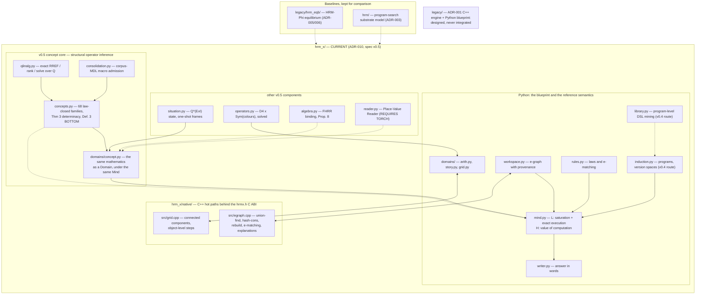

# 🧠 HRM-X Knowledge Dashboard

> [!IMPORTANT] What this vault describes today
> The live model is **HRM-X v0.5 — structural operator inference** (spec v0.5,
> [[ADR-010 Structural Operator Inference]]), in `hrm_x/`. A hypothesis is a law-closed family
> fitted exactly over ℚ, not a program found by enumeration. **Gates G4 and G5 are not met** —
> read ADR-010 before quoting a headline. The notes under `01`–`05` were written for the
> ADR-001 "Python blueprint + C++ engine" design, which **was never built**; ADR-003 moved it to
> `legacy/`. They are kept as design history, not as a description of the code. For the code
> that actually exists, use [[Code Map]].

Welcome to the internal engineering knowledge base for **HRM-X**: a reasoner that infers
*operators* from evidence and applies them exactly to *structured situations*, checking each
answer in an independent representation.

---

## 🧬 Three generations, all present in the repo

| Generation | Path | Role | Standing |
| :--- | :--- | :--- | :--- |
| `hrm_x/` | ADR-010, spec v0.5 | **Current model.** Law-closed hypothesis families fitted exactly over ℚ, determinacy, open-world coverage, VOC control, dual-solve verification. The v0.4 program-search route (`domains/arith.py`, `library.py`) stays inside it as the comparison baseline. C++ hot paths in `hrm_x/native/`. | live |
| `legacy/hrm_eqb/` | ADR-005, ADR-006 | HRM-Phi equilibrium baseline: neural H/L trained on algebra. It measured no arithmetic (ADR-006), which is why it was replaced. Built and measured, then moved out of the live tree on 2026-09-29 (`legacy/README.md`); its 55 tests now live in `legacy/tests/` and no longer run by default. | superseded, in `legacy/` |
| `hrm/` | ADR-003 | The first unified cognitive model: program search over a phasor substrate. | baseline |
| `legacy/` | ADR-001, ADR-002 | The C++ engine plus Python blueprint design. **Never integrated with the live model.** | historical |

---

## ⚡ Current architecture

Exact `Fraction` arithmetic stays in Python on purpose (ADR-008): arbitrary precision is the
guarantee, so the C++ accelerates only the e-graph and the grid, and parity with the Python
reference is tested differentially (`tests/test_x_native.py`).

---

## 📊 Quick metrics (measured, `experiments/results/*.json`)

- **Tests**: `python -m pytest` → **442 passed, 1 skipped** (2026-09-29, ADR-012; native DLL built — without it 5 parity tests skip).
- **Exact extrapolation (E1)**: **1.000** on every split — in-range, 10²–10⁴ integers, large decimals, 10×3.1.
- **Composition (E2)**: **1.000** at depths 1–3.
- **Native backend**: results identical to Python; grid **3.79×**, arithmetic **1.47×**.
- **v0.5 vs v0.4, one mind (E13)**: as ported, in-language 13/15 at 593 ops against 7/15 at 4,265 ops (7.2x cheaper) and out-of-language 5 confidently wrong of 6 ([[ADR-010 Structural Operator Inference]]). **Since ADR-012** (BOTTOM counts inside `Mind`): in-language **9 / 2 / 4**, out-of-language **0 / 0 / 6**; held-out operators: out-of-language wrong 16 → 2, in-language correct 36 → 22.
- **HRM-EQB audit (ADR-012)**: core linear in its input (additivity error 6.6e-8), 1 vs 40 cycles same accuracy (0.317 / 0.315), text 0.956 on training words vs 0.006 on unseen strings; retrained on random strings (EQB-T, one seed) it reaches 0.14–0.20 on unseen strings, almost all of it `upper`, and 0.000 at longer lengths. See [[ADR-012 EQB and HRM-X Audit - Linear Core, Recalled Language, Live BOTTOM]].
- **HRM-X v0.6 (ADR-013), E19 held-out 81 tasks**: **60 / 0 / 21** (correct / wrong / abstain) vs 18 / 0 / 63 for v0.5 + ADR-012; memory off 44 / 0 / 37; closed world 63 / 12 / 6. See [[evaluation]].
- **Experiment result files**: **20** in `experiments/results/` (`eqb_probe.json`, `eqb_text.json`, `x_margin.json` added by ADR-012).

---

## 🧭 Navigation & Maps of Content (MOCs)

| Knowledge Hub | Focus Area | Direct Link |
| :--- | :--- | :--- |
| **Master Index** | Complete vault graph and topic index | [[Master MOC]] |
| **How It Works** | Architecture, the algorithms, and the current situation | [[How It Works]] |
| **Code Map** | Which document is implemented by which file | [[Code Map]] |
| **Current spec** | HRM-X v0.5, structural operator inference (normative) | [[HRM-X Specification v0.5 - Structural Operator Inference]] |
| **Decision Records** | ADR-010 is current; the ADRs it replaced are kept verbatim | [[ADR-010 Structural Operator Inference]] · [[ADR-011 Reintroducing EQB Ideas into HRM-X]] |
| **HRM-X v0.5 concepts** | One note per v0.5 module | [[HRM-X Concept Induction (v0.5)]] |
| **Python subsystems** | One note per module of `hrm_x/`, `hrm_eqb/`, `hrm/` | [[HRM-X Workspace & Rules]] |
| **The only C++** | E-graph and grid kernels behind `hrmx.h` | [[HRM-X Native Backend]] |
| **Build & Toolchain** | `scripts/build_native.ps1`, `python -m pytest` | [[Build & Toolchain Guide]] |

### Historical — the ADR-001 design that was never built

| Knowledge Hub | Focus Area | Direct Link |
| :--- | :--- | :--- |
| **System Philosophy** | Why Python blueprint + C++ engine | [[Hybrid System Philosophy]] |
| **HRM+LLM Fusion** | Research brief, architectures A–E | [[HRM+LLM Fusion Architecture]] |
| **Tensor Data Flow** | Shape mappings $(B, T) \to (B, D) \to (B, V)$ | [[Tensor Flow & Data Pipelines]] |
| **C++ Engine & Kernels** | Arena, tensor views, thread pool, kernels | [[Engine Architecture & Memory Model]] |
| **Python Blueprint** | Declarative layout API, graph mutators, configs | [[Model Blueprint & Graph Layout]] |
| **C-ABI & Interop** | The `hrm_c_api.h` that was never written | [[C-ABI & Interop Specification]] |
