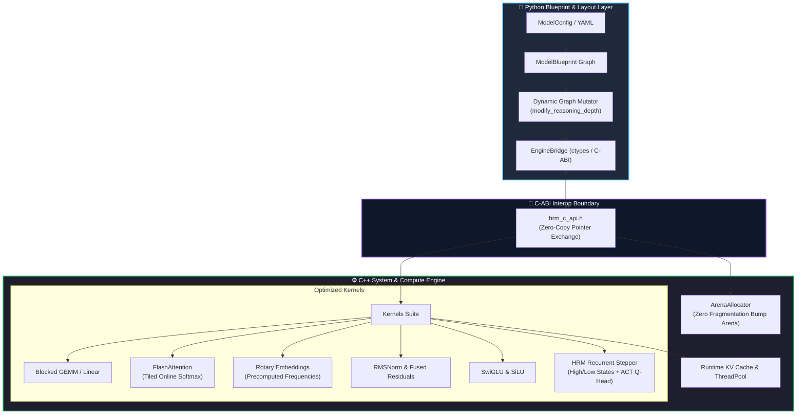

# 🧠 HRM+LLM Hybrid AI Architecture Dashboard

Welcome to the internal engineering knowledge base for the **Hierarchical Reasoning Model (HRM) + Large Language Model (LLM)** fusion system.

> [!IMPORTANT]
> **Core Architectural Paradigm**:
> - **Python Layer**: Serves as the declarative **blueprint / layout** of the neural network graph. Researchers inspect, mutate, and explore model configurations rapidly without touching compiled code.
> - **C/C++ System Layer**: Executes **all compute operations**: cache-blocked GEMMs, online-softmax FlashAttention, RoPE, RMSNorm, zero-fragmentation memory arenas, and the recursive HRM multi-timescale reasoning loop with ACT halting.

---

## 🧭 Navigation & Maps of Content (MOCs)

| Knowledge Hub | Focus Area | Direct Link |
| :--- | :--- | :--- |
| **Master Index** | Complete vault graph and topic index | [[Master MOC]] |
| **System Philosophy** | Why Python blueprint + C++ system engine | [[Hybrid System Philosophy]] |
| **HRM+LLM Fusion** | Research & architecture design (Architectures A–E) | [[HRM+LLM Fusion Architecture]] |
| **Tensor Data Flow** | Explicit shape mappings $(B, T) \to (B, D) \to (B, V)$ | [[Tensor Flow & Data Pipelines]] |
| **C++ Engine & Kernels** | Low-level C++ engine, memory arena, kernels | [[Engine Architecture & Memory Model]] |
| **Python Blueprint** | Declarative layout API, graph mutators, configs | [[Model Blueprint & Graph Layout]] |
| **C-ABI & Interop** | ctypes & pybind11 zero-copy interop protocol | [[C-ABI & Interop Specification]] |
| **Build & Toolchain** | CMake, Clang++, MSVC build instructions | [[Build & Toolchain Guide]] |
| **Decision Records** | Architectural Decision Records (ADRs) | [[ADR-001 Hybrid C++ Engine with Python Blueprint]] |

---

## ⚡ High-Level System Architecture Diagram

---

## 📊 Quick System Metrics

- **Backbone Supported**: LLaMA/Mistral-style Decoder Transformer (RMSNorm, SwiGLU, RoPE, GQA/MHA).
- **Reasoning Module**: HRM 2-level Recurrent Engine (High-level Planner $z_H$, Low-level Executor $z_L$).
- **Halting Controller**: Adaptive Computation Time (ACT) Q-Head with dynamic thresholding.
- **Engine Allocation**: 64-byte aligned static memory arena; zero dynamic `malloc` during inference passes.
