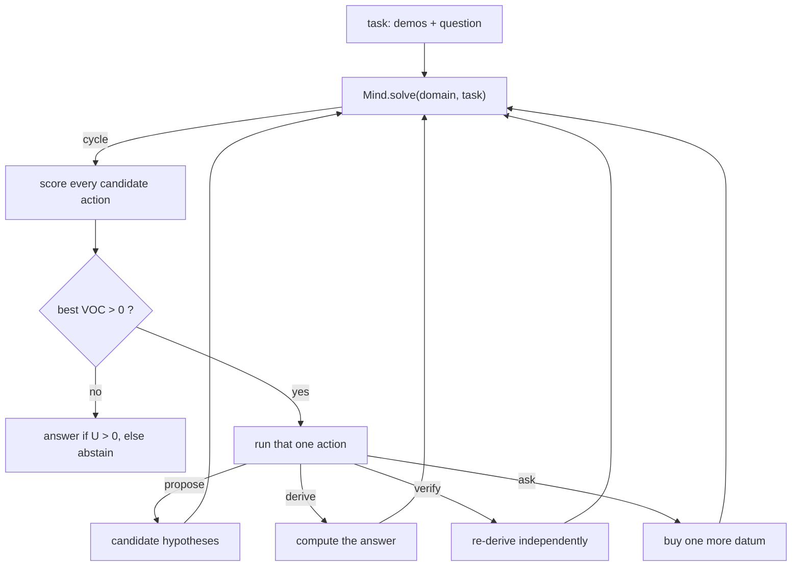

# How It Works

An orientation to the current architecture, the algorithms it actually runs, and
an honest account of where it stands. The **spec** says what is claimed; the
**ADRs** say what was decided and measured; this page says how the thing works
and what is not finished. Normative source: spec v0.5 (ADR-010).

---

## 0. The shape of the thing

The problem being attacked: **understand a task well enough to answer a question
about it, and know when you do not.**

A task is a **situation + operator + question**. Given worked examples of an
unknown operator `×`, infer what it means, execute it exactly, and get a
question answered. Refuse rather than guess.

The system is a **loop**, not a network. There is no embedding layer, no
pretraining, no transformer except one small tagger used for reading sentences.
Two loops, at two speeds:

- **L (low level)** — do the work: saturate rules to a fixpoint, or solve one
  linear system exactly. Deterministic, exact, terminates.
- **H (high level)** — decide *how much* work to do. A value-of-computation
  controller scores candidate actions and stops when none is worth its cost.



**Two inference routes share this one loop.** That is the key structural fact:

| | route | hypothesis | status |
|---|---|---|---|
| A | `domains/concept.py` + `concepts.py` | a **law-closed family**, fitted exactly | **the model** (v0.5) |
| B | `domains/arith.py` + `library.py` | a **program** found by enumeration | kept as the measured baseline (v0.4) |

They are not alternatives in the code — they are the same `Domain` interface
driven by the same controller, which is what makes the head-to-head in §6 fair.

---

## 1. The shared skeleton

Everything the mind knows is a `Hyp`: a key, a weight, a payload, and the
answer it produced. The belief over hypotheses is the posterior; the controller
only ever manipulates that list.

A **domain** must provide (`hrm_x/mind.py`):

| method | question it answers |
|---|---|
| `propose(task, level, mind)` | what could explain the evidence? returns hypotheses + ops, or `None` when exhausted |
| `propose_cost`, `derive_cost` | what would it cost, *before* doing it |
| `derive(task, hyp, mind)` | compute this hypothesis's answer |
| `verify(task, hyp, mind)` | re-derive the answer a different way |
| `questions`, `ask` | what could I buy, and record the answer |
| `remember` | keep the surviving version space |

Optional hooks the controller probes with `getattr`: `predict` (cheap guess, used
to group hypotheses), `feedback`, `sleep`.

---

## 2. The H level: value of computation

From `hrm_x/mind.py`, verbatim:

```
q(y) = Σ_h p_h · r_h · [y_h = y]        r_h = 1 if verified else ρ
U    = max(0, max_y (1 + L)·q(y) − L)
VOC(a) = E[U after a] − U − λ·cost(a)
```

- `L` is the price of a wrong answer (`Controller.wrong_penalty`, default 1.0).
- `ρ` is the remembered success rate of verification, a Beta(4,1) prior at start.
- `λ` is the price of computation (`Controller.lam`, default 2e-5).

Each cycle the controller scores up to four kinds of action and runs the best, if
its VOC is positive:

1. **propose** — get candidates. VOC is `P(finds something) − λ·propose_cost`.
2. **derive** — compute an answer. Scored on the utility *gain* minus cost.
3. **verify** — re-derive. Expected gain is
   `ρ·U(passed) + (1−ρ)·U(failed) − U`, so verification is worth doing when the
   mind is not yet sure and verification has been reliable before.
4. **ask** — buy a datum. `E[U after hearing] − U − λ·ask_ops`.

**The derive-group macro-action** is the one non-obvious piece. A one-step
lookahead cannot see that two 50%-weight hypotheses that *agree* on the answer
together make answering worthwhile. So hypotheses are grouped by what the
domain's cheap `predict` says, and the group is derived at once; the gain is
computed against the mass that survives answerability conditioning.

**Patience** can learn λ from the observed value-per-op, but is **off by
default**: `experiments/x_patience.py` measured it at **−0.90 / −0.36** accuracy
against the best fixed λ in its own reachable range. The rule is kept and tested;
the constant is what ships.

**Termination**: the loop stops when no action has VOC > 0, or `max_cycles`
(default 40). Then it answers if `U > 0` and abstains otherwise. Abstention is a
first-class outcome, not a failure.

---

## 3. Route A — structural operator inference (the current model)

The problem it solves: v0.4 had to *search* for an operator over a hand-written
DSL, and on operators the DSL did not contain it answered confidently wrong
(audit finding F3: 3 of 4 out-of-DSL probes wrong with status `answer`).

v0.5 changes what a hypothesis **is**.

### 3.1 The hypothesis language

A hypothesis is a **family** — the exact solution set of a law set, not an
arbitrary program:

```
m(x, y) = Σ_j p_j · ψ_j(x, y),     p ∈ ℚ^k
```

`hrm_x/concepts.py` builds **68** of them: all 15 non-empty supports over
{xy, x, y, 1} (bi-affine), 45 monomials `c·x^a·y^b` with a,b ∈ [−3,3]
(multiplicative in each argument), 2 exp-powers `c·x^(a·y)`, and 6 exponential
families. None is a program anyone wrote; each is the general solution of a law
set, and `p` is fitted exactly.

### 3.2 Exact linear algebra

`hrm_x/qlinalg.py` is stdlib-only: `rref`, `rank`, `solve`, `in_row_space`, all
over `fractions.Fraction`. Every fit is an exact RREF of the augmented matrix.
There is no floating point anywhere in this route, and no enumeration.

### 3.3 The three quantities that decide an answer

**Consistency** — does `A·p = b` have a solution? A family that cannot fit the
evidence is not a reading.

**Evidence weight (Prop. 4).** "The probability that h fits the remaining n − k
points *by chance* is |Y|^{−(n−k)}." So

```
log2 w(h) = −bits(h) − param_bits(p) + (n − rank(A))·log2|Y| + symmetry bonus
```

Only the **surplus** rows — the ones the family *predicts* rather than fits —
buy evidence. Fitted parameters buy none. Asserted exactly in
`test_fitted_parameters_buy_no_evidence`.

**Determinacy (Theorem 3).** "If the evidence is consistent, φ(g) is uniquely
determined **iff** g ∈ span_ℚ{xᵢ}." So a reading may answer **only** where its
feature row is in the row space of the evidence matrix. Outside it, the reading
has no opinion and its posterior mass is reported as undetermined rather than
guessed.

### 3.4 The open-world rules

**BOTTOM** — a reserved hypothesis meaning "the concept is outside my language",
holding prior mass `2^-bits_bottom` with no evidence term. In the closed world
(`bits_bottom = ∞`) it holds nothing and the best-fitting family wins regardless.

**Coverage** — moving an argument to a value that never varied in the evidence is
supported only if that argument varied, or the reading is symmetric in x, y.
This is not decoration: any `g(x)·h(y)` with `h` fixed on the seen values fits
evidence in which `y` never moved.

### 3.5 Verification is a different computation

`derive` evaluates the primal `Σ_j p_j·r_j`. `verify` solves the **dual**
`Aᵀλ = r` and reads the answer off the right-hand side as `Σ_i λ_i·bᵢ`, then
requires exact rational equality.

Why this is not the same computation twice: Theorem 3 says the value is
determined only because the query row is in the row space of `A` — equivalently,
only because the dual is consistent. So the second number is derived from the
data rather than from the parameters, and a transposed basis, a free-variable
artefact or a corrupted parameter vector shows up as a disagreement. It also
fails for the right reason when the query genuinely is undetermined, because
`solve` returns `None` on an inconsistent dual rather than inventing a
least-squares answer. Pinned by
`test_verification_catches_a_reading_whose_parameters_were_corrupted`.

### 3.6 Consolidation

`hrm_x/consolidation.py` — a solved task leaves a fitted reading; a candidate
macro μ is that reading; μ is admitted when its corpus MDL gain exceeds its own
description cost. Once admitted it becomes a **feature**, so the hypothesis
language grows. Measured: one solved task has **negative** gain and is rejected;
the same reading three times is admitted.

### 3.7 What it costs

Deriving is a lookup; the expensive part is the fit, charged once in `propose`.
That asymmetry is why this route is cheaper: 593 ops against v0.4's 4,265 on
in-language operators.

---

## 4. Route B — program search (v0.4, kept as the baseline)

Same loop, different hypothesis space. Kept because it is what route A is
measured against, and because its ideas are sound.

### 4.1 The situation model: an e-graph where every equality has a reason

`hrm_x/workspace.py`. A task's knowledge is one object: terms `f(c₁..c_k)` over
e-class ids, equality closed under congruence, every union carrying a `Why`
(rule + assumptions). A contradiction — two different constants forced into one
class — is **recorded with the premises to blame**, not raised. Explanations
reach the facts used. Vector similarity never creates an equality.

### 4.2 Rules: e-matching and bounded saturation

`hrm_x/rules.py`. A rule is `lhs => rhs` with an optional guard and the
assumptions it rests on. Firing adds the equality with its `Why`; **nothing is
ever deleted**, so every conclusion stays explainable. The right side may be a
callable, which is how exact primitive operations (constant folding) enter the
same machinery. `close()` is QuickSpec-style conjecture pruning; `saturate()` runs
to a fixpoint under a firing and round budget.

### 4.3 Induction: observational equivalence

`hrm_x/induction.py`, one idea used twice — evaluate candidates on shared probes
and group identical fingerprints:

- **hypotheses**: programs consistent with the evidence, grouped into behaviour
  classes; a class's prior mass is `Σ 2^-size`, so shorter programs count more;
- **laws**: terms in one class give conjectured equations, kept only if the
  laws accepted so far do not already derive them.

Laws are *tested conjectures with a stated domain, not proofs*: a law false on a
fraction ε survives n probes with probability at most `(1−ε)^n`.

### 4.4 Growing the DSL

`hrm_x/library.py`, DreamCoder-style MDL. Naming a body `t` with holes `H` costs
`|t| + 1` to declare and saves `|t| − 1 − Σ|arg|` at every use. Both terms matter
and the first version got it wrong: it assumed a use saved `|t| − 1`, so
abstracting `add(a, x)` — whose only argument is the single node `a` — appeared
to save a node per use when it saved nothing, and it declined every primitive the
domain actually needs.

**Measured negative result**: compression works (MDL 40→38, exact expansion),
but search got *more* expensive, 4,218 → 9,615 propose ops, because an arity-1
constructor multiplies the programs at every size. So `use_library_bound`
defaults to **off**.

### 4.5 The three domains

| domain | what is given | what is learned | how it is verified |
|---|---|---|---|
| `arith.py` | exact rationals, `add`, `iter` | the meaning of a symbol, as a program; laws, in sleep | **residue phasors** (Kymn et al.) — the question re-evaluated *from the definition* in a different representation, closed-form exponentiation instead of iteration |
| `story.py` | a role vocabulary | a 40,908-parameter tagger that labels tokens and schema | replay the same reading as a **plain dict** and check conservation |
| `grid.py` | object extraction, 4-connectivity | the step sequence | three strictness levels: `LENIENT` (search), `EXERCISED` (a demo must select something unambiguously), `APPLICABLE` (the test input must also be unambiguous) |

Note what each verifier can and cannot see. The arith verifier catches wrong
laws and wrong execution — **not** a wrong concept that fits all evidence, which
is what questions are for.

### 4.6 The native backend

`hrm_x/native/` is C++ behind a pure C ABI (`hrmx.h`), loaded by ctypes, holding
exactly the two profiled hot paths: **connected components** and the **e-graph**.
`make_workspace()` picks it when `HRMX_BACKEND` is `auto` (the default) or
`native` and the DLL exists; Python stays the reference and the differential
parity test checks the two agree on random inputs. Measured **3.79×** on grid,
**1.47×** on arithmetic, identical results.

Exact rational arithmetic deliberately stays in Python: arbitrary precision *is*
the guarantee, and Amdahl caps that at ~1.5×, which is accepted.

---

## 5. Perception — the part that is known not to work

`domains/story.py` is the honest case study. Its design claim was that surface
form is convention, "which is why this part is learned". That was never tested
against held-out *wording*.

`experiments/x_perception.py` trained the tagger on its 12 templates and scored
its top reading against an independent hand-written reader:

| variation | exact |
|---|---|
| seen forms | 1.00 |
| only the verb changed | 0.50 |
| **only the clause order changed** | **0.00** |
| question reordered | 0.67 |

76–93% of held-out stories contain a misread. The verifier **cannot** see it,
by construction: `Story.verify` replays the reader's own `Reading` through a
different representation. Safe failure is the property of `reading_defect`, a
structural guard, not of verification — and that guard has been found incomplete
twice. See ADR-009.

---

## 6. Current situation

### What the gates say

| gate | claim | state |
|---|---|---|
| G1 mathematics | every quantity exact over ℚ; Theorem 3 / Prop. 4 / Prop. 8 tested against the code | **met** |
| G2 representation | a reading is a law-closed family, fitted exactly, never enumerated | **met** |
| G3 capability | in-language operators answered exactly and cheaply | **met** — 13/15 at 7.2× fewer ops than v0.4 |
| G4 generalization | operators outside the language are *refused* | **NOT met** — 5 confident wrong out of 6 |
| G5 anti-shortcut | no result explained by the task distribution | **NOT met** — see below |
| G6 efficiency | metareasoning cost bounded and small | **NOT met** — 35k meta ops against 3.3k object ops |

### The head-to-head (E13, both routes, one `Mind`, `experiments/results/x_v05.json`)

| E13a, 21 queries | correct | wrong | abstain | mean ops |
|---|---|---|---|---|
| **concept v0.5** | **14** | 7 | 0 | **751.5** |
| arith v0.4 | 9 | 4 | 8 | 4247.2 |

Read in both directions. **In-language (15): 13/2/0 at 593 ops against 7/4/4 at
4,265** — better on every axis and 7.2× cheaper. **Out-of-language (6): 1/5/0
against 2/0/4** — *worse than the route it replaces*.

### Why G4 is not met, precisely

The determinacy test stops a reading extrapolating outside the evidence span.
It cannot stop a **different reading that fits the evidence exactly** from being
confirmed. On `a²+b` with evidence `(2,3)→7, (4,3)→19`, the full bi-affine
family `3/2·xy + 3/2·x − 2y + 1` fits both rows. The coverage rule refuses it at
`(5,7)`. Then the controller **asks one question**; the answer brings a second
value of `y` into the evidence; `y` has now "varied"; the rule stops firing. The
dual confirms. The mind answers 47 where the truth is 32.

> The coverage rule asks "did this argument ever take a different value?", and
> **the act of asking is what makes it take one.**

Both halves are pinned by tests, so a later fix has to break them:
`test_one_question_destroys_the_coverage_guard`,
`test_a_coincidental_symmetric_fit_is_still_confidently_wrong`.

### What is not wired

Honesty about the v0.5 port: **7 modules were ported, 2 are used by a
measurement.** `qlinalg` and `concepts` are exercised end-to-end by
`x_v05.py`. The rest have tests but no experiment runs them:

| module | situation |
|---|---|
| `consolidation.py` | tested; the delivery's E8 held-out experiment was not ported |
| `situation.py` | tested; the delivery's E5 story experiment was not ported |
| `algebra.py` | tested; the delivery's E1 binding-capacity experiment was not ported |
| `operators.py` | tested; the delivery's E6 grid experiment was not ported |
| `reader.py` | **not tested at all**; the delivery's E2/E3 were not ported |
| `writer.py` | v0.4; `explain()` is never called at runtime, only from a test |

The diagnosis is not that these are dead — it is that **the experiments that
exercise them were never ported**. The delivery shipped E1–E8; this repository
ported E4/E8-analogue only.

### What is proposed next

`ADR-011` (proposed, not implemented) takes HRM-EQB's *method* — certify a
quantity, not a model — and points it at objects route A already computes:

- **A. Rival-margin bound** on the answer: carry the determinacy certificate
  *and* `log2 q(top) − log2 q(best rival that disagrees)`. This is the fix for
  G4, and its first step is a **measurement**, not code: if the wrong
  out-of-language answers carry margins as large as the correct in-language
  ones, it is the wrong fix.
- **B. Leave-one-out provenance** on every stored concept (EQB's `V1`/`E_loo=0`),
  cheap here because the fit is exact.
- **C. A held-out keep gate** on macro admission (EQB's `G1`), which runs doc 13's
  own untested falsifier that consolidation might be memorising.

### Repository state

- **381 passed, 1 skipped** in the default suite; 128 of those are HRM-X.
  55 HRM-EQB tests moved to `legacy/tests/` (still passing on demand) when an
  audit found no non-test code imported that package.
- 12 recorded experiment results in `experiments/results/`; every number above
  is read from one of them.
- Knowledge graph: 2,660 → 295 nodes, with `legacy/` excluded on purpose.

---

## 7. Where to read next

| if you want | read |
|---|---|
| the normative design | [[HRM-X Specification v0.5 - Structural Operator Inference]] |
| why v0.5 exists and what it cost | [[ADR-010 Structural Operator Inference]] |
| what HRM-EQB is worth | [[ADR-011 Reintroducing EQB Ideas into HRM-X]] |
| module ↔ document | [[Code Map]] · [[00 - Code Subsystems]] |
| gates, debt, next steps | [[Task Plan]] |
| the visual map | `vault/Knowledge Graph/System Knowledge Graph.canvas` |
| what perception cannot do | [[ADR-009 Free Text Is Not Yet Supported]] |

Attribution: opencode/stealth/space-bunny-alpha (space-bunny-alpha), 2026-09-30.
