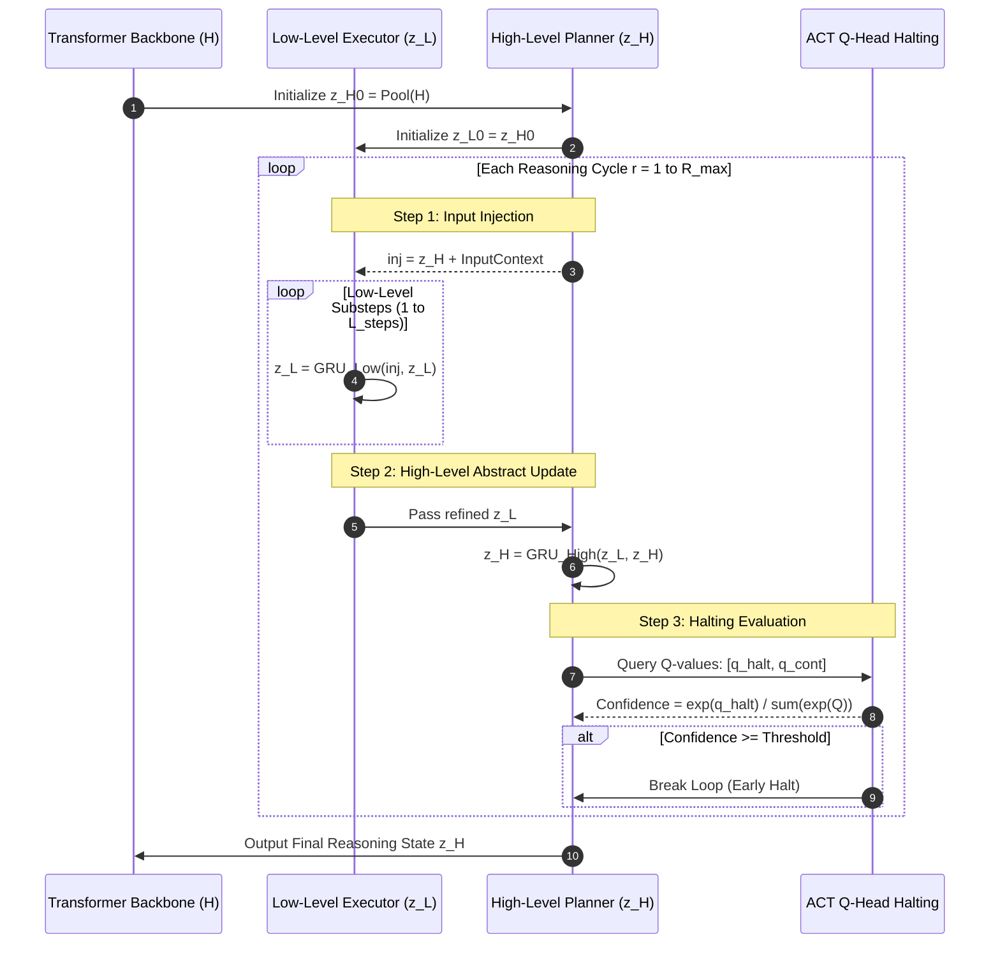

# 🧠 HRM+LLM Fusion Architecture

This document details the engineering fusion of the **Hierarchical Reasoning Model (HRM)** (Wang et al., 2025; sapientinc/HRM) with modern **Transformer Large Language Models (LLMs)**.

---

## 🔬 Background: HRM vs LLM Paradigms

| Property | Modern LLM (e.g. LLaMA / Mistral) | HRM (Hierarchical Reasoning Model) |
| :--- | :--- | :--- |
| **Computation Model** | Fixed feedforward depth (e.g. 24 or 32 layers) | Recursive multi-timescale iterations |
| **Reasoning Mode** | Shallow, statistical, emergent via Chain-of-Thought tokens | Deep, explicit, algorithmic internal state search |
| **Parameter Footprint** | Massive (7B – 70B+ parameters) | Compact (~27M – 100M parameters) |
| **Halting Mechanism** | None (fixed forward pass per token) | **Adaptive Computation Time (ACT)** via learned $Q$-head |
| **Data Requirement** | Billions/trillions of raw text tokens | Few thousand structured symbolic/reasoning samples |

---

## 🏗️ Architectural Fusion Candidates (Survey from Executive Summary)

```mermaid
graph TD
    subgraph ArchA["Architecture A: Separate Reasoner (Selected Starting Point)"]
        InA["User Tokens"] --> LLM_Enc["Transformer Backbone"]
        LLM_Enc --> State_H["Context State H"]
        State_H --> HRM_Mod["HRM Recurrent Module (z_H, z_L)"]
        HRM_Mod --> Dec_Head["Decoder Head"]
        Dec_Head --> OutA["Output Logits"]
    end

    subgraph ArchC["Architecture C: Latent Reasoning Loop"]
        InC["Tokens"] --> Layer1["Initial Layers"]
        Layer1 --> LatentLoop["Iterative Latent Loop: z_new = f(z_old)"]
        LatentLoop --> Layer2["Final Layers"]
        Layer2 --> OutC["Output Logits"]
    end
```

### Evaluation of Candidates:
1. **Architecture A (Separate HRM Module + Transformer Backbone - Selected)**:
   - *Design*: Standard pretrained Transformer encodes sequence context into $H$. An HRM reasoning module iteratively refines the state before passing it to the decoder head.
   - *Advantages*: Clean modularity. The LLM backbone retains broad linguistic knowledge; the HRM module is trained as an efficient reasoning accelerator.
2. **Architecture B (Hierarchical Inside Transformer)**:
   - Nested recurrence within individual Transformer blocks. Breaks layer-wise parallelism and makes off-the-shelf pretrained weight reuse difficult.
3. **Architecture C (Latent Reasoning Loop)**:
   - Extra hidden-state updates executed between token generations. Combined with Architecture A in our system design via the ACT-controlled latent reasoning pass.
4. **Architecture D (Adaptive Computation Time / ACT)**:
   - Dynamic step budget. Integrated directly into our HRM module via the $Q$-head halting evaluator.
5. **Architecture E (Mixture of Experts Reasoning)**:
   - High routing complexity; deferred for future multi-domain scaling.

---

## 🔄 The Multi-Timescale Recurrence Loop

The HRM reasoning engine operates with two interdependent recurrent state vectors:
- $z_H \in \mathbb{R}^{B \times D}$: High-level planner (slow timescale, abstract reasoning).
- $z_L \in \mathbb{R}^{B \times D}$: Low-level executor (fast timescale, detailed step computation).

---

## ⚡ Adaptive Computation Time (ACT) Formulations

At each reasoning cycle $r$, the $Q$-head produces two logits:
$$
\begin{bmatrix} q_{\text{halt}} \\ q_{\text{continue}} \end{bmatrix} = W_Q z_H + b_Q
$$
The normalized halting confidence is computed via softmax:
$$
p_{\text{halt}} = \frac{e^{q_{\text{halt}}}}{e^{q_{\text{halt}}} + e^{q_{\text{continue}}}}
$$
If $p_{\text{halt}} \ge \tau_{\text{ACT}}$, the C++ kernel immediately halts iteration, achieving dramatic latency savings on easy queries while allowing full multi-step reasoning on difficult tasks.

---

## 🔗 Related Notes
- [[Hybrid System Philosophy]] — Python blueprint vs C++ engine separation.
- [[Tensor Flow & Data Pipelines]] — Explicit tensor shapes across layers.
- [[HRM Recurrent Stepper & ACT]] — C++ implementation of this recurrence algorithm.
