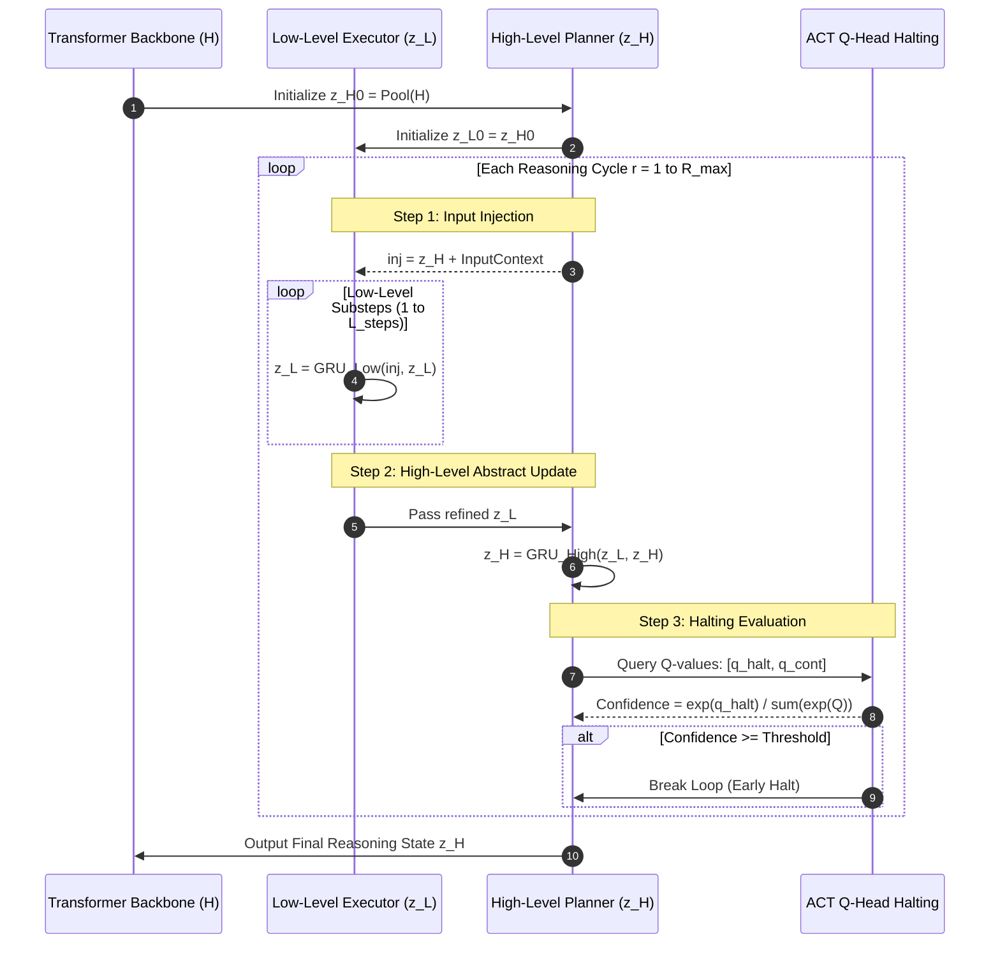

# 🧠 HRM+LLM Fusion Architecture

> [!NOTE] Historical
> This is a **research brief from 2026-09-26; nothing in it was implemented.** No LLM backbone
> was ever attached to an HRM: there is no transformer decoder, no token vocabulary of 32,000, and
> no fused model in this repository. The design was overtaken twice — ADR-005/006 built the
> HRM-Phi equilibrium model *instead* (and it measured no arithmetic, ADR-006), and ADR-008
> replaced even that with operator inference. Kept because the HRM-vs-LLM comparison table and
> the A–E architecture survey are the honest record of what was considered and why this path was
> dropped.

> [!IMPORTANT] The data path that actually exists
> There is no $(B, T) \to (B, D) \to (B, V)$ pipeline. The real path is:
> **situation + operator + question** →
> `hrm_x/workspace.py` (an e-graph holding the situation, with provenance) →
> `hrm_x/rules.py` (laws, proposed by theory exploration, pruned by congruence closure) →
> `hrm_x/induction.py` (a posterior over programs, held as version spaces) →
> `hrm_x/mind.py` (L: saturation, extraction and exact execution; H: value of computation over
> {propose, derive-group, verify, ask, stop}) →
> `hrm_x/writer.py` (the answer in words) →
> an **independent verifier** (residue-phasor replay for arithmetic, dictionary replay plus
> conservation for stories, applicability conditions for grids).
> The only transformer is a convention-layer tagger of 40,908 parameters that copies names and
> numbers by role (ADR-008). LLM backbones, token streams and logits are absent by design.

The comparison table and the multi-timescale loop below describe the **HRM-Phi line that was
actually built in `hrm_eqb/` as a baseline** — the GRU/ACT formulation there was replaced by the
contraction-based equilibrium solver. The C++ kernel claims were never implemented at all.

---

## 🔬 Background: HRM vs LLM Paradigms

| Property | Modern LLM (e.g. LLaMA / Mistral) | HRM (Hierarchical Reasoning Model) |
| :--- | :--- | :--- |
| **Computation Model** | Fixed feedforward depth (e.g. 24 or 32 layers) | Recursive multi-timescale iterations |
| **Reasoning Mode** | Shallow, statistical, emergent via Chain-of-Thought tokens | Deep, explicit, algorithmic internal state search |
| **Parameter Footprint** | Massive (7B – 70B+ parameters) | Compact (~27M – 100M parameters) |
| **Halting Mechanism** | None (fixed forward pass per token) | **Adaptive Computation Time (ACT)** via learned $Q$-head |
| **Data Requirement** | Billions/trillions of raw text tokens | Few thousand structured symbolic/reasoning samples |

---

## 🏗️ Architectural Fusion Candidates (Survey from Executive Summary)

```mermaid
graph TD
    subgraph ArchA["Architecture A: Separate Reasoner (Selected Starting Point)"]
        InA["User Tokens"] --> LLM_Enc["Transformer Backbone"]
        LLM_Enc --> State_H["Context State H"]
        State_H --> HRM_Mod["HRM Recurrent Module (z_H, z_L)"]
        HRM_Mod --> Dec_Head["Decoder Head"]
        Dec_Head --> OutA["Output Logits"]
    end

    subgraph ArchC["Architecture C: Latent Reasoning Loop"]
        InC["Tokens"] --> Layer1["Initial Layers"]
        Layer1 --> LatentLoop["Iterative Latent Loop: z_new = f(z_old)"]
        LatentLoop --> Layer2["Final Layers"]
        Layer2 --> OutC["Output Logits"]
    end
```

### Evaluation of Candidates:
1. **Architecture A (Separate HRM Module + Transformer Backbone - Selected)**:
   - *Design*: Standard pretrained Transformer encodes sequence context into $H$. An HRM reasoning module iteratively refines the state before passing it to the decoder head.
   - *Advantages*: Clean modularity. The LLM backbone retains broad linguistic knowledge; the HRM module is trained as an efficient reasoning accelerator.
2. **Architecture B (Hierarchical Inside Transformer)**:
   - Nested recurrence within individual Transformer blocks. Breaks layer-wise parallelism and makes off-the-shelf pretrained weight reuse difficult.
3. **Architecture C (Latent Reasoning Loop)**:
   - Extra hidden-state updates executed between token generations. Combined with Architecture A in our system design via the ACT-controlled latent reasoning pass.
   - *Never built.* A latent loop of this shape **was** built in `hrm_eqb/` as the HRM-Phi equilibrium solver, but on phasor states with a certified contraction bound, not with a token-conditioned ACT pass.
4. **Architecture D (Adaptive Computation Time / ACT)**:
   - Dynamic step budget. Integrated directly into our HRM module via the $Q$-head halting evaluator.
   - *Never built in the $Q$-head form.* What shipped is a **value-of-computation** controller: H asks whether $U > 0$ and whether any action is worth its cost, over {propose, derive-group, verify, ask, stop} (ADR-008).
5. **Architecture E (Mixture of Experts Reasoning)**:
   - High routing complexity; deferred for future multi-domain scaling.
   - *Never built.* `hrm_x/domains/` dispatches by domain in Python, with no learned routing.

> [!CAUTION] "Selected Starting Point" was not selected
> Architecture A is labelled selected in the diagram below, but no fused HRM+LLM model was ever
> trained. Do not read the diagram as a record of a decision that was carried out.

---

## 🔄 The Multi-Timescale Recurrence Loop

The HRM reasoning engine operates with two interdependent recurrent state vectors:
- $z_H \in \mathbb{R}^{B \times D}$: High-level planner (slow timescale, abstract reasoning).
- $z_L \in \mathbb{R}^{B \times D}$: Low-level executor (fast timescale, detailed step computation).

---

## ⚡ Adaptive Computation Time (ACT) Formulations

At each reasoning cycle $r$, the $Q$-head produces two logits:
$$
\begin{bmatrix} q_{\text{halt}} \\ q_{\text{continue}} \end{bmatrix} = W_Q z_H + b_Q
$$
The normalized halting confidence is computed via softmax:
$$
p_{\text{halt}} = \frac{e^{q_{\text{halt}}}}{e^{q_{\text{halt}}} + e^{q_{\text{continue}}}}
$$
If $p_{\text{halt}} \ge \tau_{\text{ACT}}$, the C++ kernel immediately halts iteration, achieving dramatic latency savings on easy queries while allowing full multi-step reasoning on difficult tasks.
> [!CAUTION] Never implemented
> There is no $W_Q z_H$ halting head and no C++ kernel to break out of. The "dramatic latency
> savings" figure was never measured. The current controller spends computation only where its
> expected value exceeds its cost (ADR-008), and its measured adaptive-compute result is E9:
> VOC 1.000 in 248 ops on easy tasks and 0.975 in 4,346 on hard ones, against 3,836 / 10,182 for a
> fixed policy and 0.75 for greedy on hard.

---

## 🔗 Related Notes
- [[Hybrid System Philosophy]] — Python blueprint vs C++ engine separation. *(historical)*
- [[Tensor Flow & Data Pipelines]] — Explicit tensor shapes across layers. *(never implemented)*
- [[HRM Recurrent Stepper & ACT]] — C++ implementation of this recurrence algorithm. *(never implemented)*
- [[HRM-X Specification v0.4 - Operator Inference over Structured Situations]] — **the architecture that exists** (H/L as a separation of computation, not two networks).
