# 🏛️ Hybrid System Philosophy

> [!NOTE] Historical
> This is the rationale behind the ADR-001 "Python blueprint + C++ engine" split. It was **overtaken, not disproved**: ADR-003 stopped building the C++ engine and unified the model in Python, and ADR-008 later reintroduced a native backend — but for *symbolic* hot paths (e-graph, grid), not for tensor math, and with no blueprint/export layer at all. The principle survives in a reduced form: **Python is the reference semantics, C++ is the accelerator, and the two are held to identical results by a differential test.** The `python/hrm_blueprint/` module, the arena, the GEMM/FlashAttention/RoPE kernel suite and `hrm_c_api.h` were never built; they live in `legacy/`. Kept because the argument about Python/C++ boundaries is still the reason `hrmx.h` is `extern "C"`.

The claim in the ADR-001 design was a **strict decoupling of architectural topology from
computational execution**. The part that held: Python owns the semantics, and the native code
must be *provably* equivalent to it. The part that did not hold: that the semantics needed to
live in a separate declarative graph layer, and that the compute worth accelerating was dense
linear algebra.

---

## 🎯 The Core Problem in Modern AI Frameworks

Traditional deep learning frameworks blur the boundary between:
1. **Model Architecture Specification**: How layers connect, what dimensions are used, what the reasoning schedule is.
2. **Computational Execution**: Allocating memory buffers, launching SIMD vector loops, managing KV-caches, and synchronizing threads.

When Python attempts to do both (e.g. running loops, slicing tensors in Python bytecode, calling hundreds of micro-kernels sequentially), significant Python GIL contention, overhead, and memory fragmentation occur. Conversely, when entire architectures are hard-coded in C++, experimentation becomes slow and painful: modifying a layer, altering an attention mechanism, or inserting an ACT halting loop requires recompiling C++ binaries.

---

## 💡 The Solution: Python Blueprint + C++ Engine

```mermaid
flowchart LR
    subgraph PythonScope["Python (Declarative Blueprint)"]
        direction TB
        A["Define Model Topology"] --> B["Configure Hyperparameters"]
        B --> C["Mutate Architecture on the Fly"]
        C --> D["Export Clean Node Graph"]
    end

    subgraph Boundary["Zero-Copy C-ABI Bridge"]
        D ==> E["hrm_c_api.h"]
    end

    subgraph CPPScope["C++ (Bare-Metal Execution)"]
        direction TB
        E --> F["Pre-allocated Memory Arena"]
        F --> G["Cache-Blocked SIMD Kernels"]
        G --> H["Multi-Threaded Work Dispatch"]
        H --> I["Sub-millisecond Forward Passes"]
    end

    style PythonScope fill:#1e293b,stroke:#38bdf8,stroke-width:2px,color:#f8fafc
    style Boundary fill:#0f172a,stroke:#a855f7,stroke-width:2px,color:#f8fafc
    style CPPScope fill:#1e1e2e,stroke:#22c55e,stroke-width:2px,color:#f8fafc
```

### 1. Python as the Blueprint Layer
> [!CAUTION] Never built
> There is no blueprint layer. `python/hrm_blueprint/` does not exist (it is `legacy/python/hrm_blueprint/`),
> there is no `ModelBlueprint` / `LayerLayout` / `HybridHRMLLMBlueprint`, and nothing exports a
> graph for a C++ engine to consume. In the current model, "blueprint" is ordinary Python
> structure: dataclasses in `hrm/config.py` and `hrm_eqb/config.py`, and functions in `hrm_x/`.

- **Role**: Pure declarative specification and orchestration.
- **Key Modules** *(as designed; all are in `legacy/`)*:
  - `python/hrm_blueprint/blueprint.py` (`LayerLayout`, `ModelBlueprint`)
  - `python/hrm_blueprint/configs.py` (`ModelConfig`, `TransformerConfig`, `HRMConfig`)
  - `python/hrm_blueprint/hybrid_model.py` (`HybridHRMLLMBlueprint`)
- **Key Capabilities** *(proposed)*:
  - Add, remove, or swap attention heads in Python.
  - Dynamically adjust the reasoning step count ($R_{max}$) or ACT confidence threshold ($\tau$).
  - Calculate parameter footprints and inspect layer connectivity immediately without compiling.

### 2. C/C++ as the Computation Engine
> [!CAUTION] As specified, never built
> `src/core/allocator.cpp`, `src/kernels/attention.cpp`, `src/kernels/hrm_loop.cpp`,
> `src/kernels/gemm.cpp` and `hrm_c_api.h` do not exist in the live tree — they are under
> `legacy/cpp_engine/`, unused. What *is* built is `hrm_x/native/src/egraph.cpp` and
> `grid.cpp` behind `hrmx.h`: no arena, no AVX2/AVX-512 paths, no OpenMP, no thread pool,
> single-threaded CPU. Its reason for existing is not GEMMs but union-find, hash-consing,
> congruence rebuild, e-matching and flood fill.

- **Role**: High-performance, zero-overhead numeric execution.
- **Key Modules** *(as designed; all in `legacy/`)*:
  - `src/core/allocator.cpp` (`ArenaAllocator` — zero heap allocations in forward pass).
  - `src/kernels/attention.cpp` (FlashAttention online-softmax tiled kernel).
  - `src/kernels/hrm_loop.cpp` (HRM multi-timescale recurrence loop with ACT).
  - `src/kernels/gemm.cpp` (Cache-blocked matrix multiplication).
- **Key Capabilities** *(proposed)*:
  - Guaranteed 64-byte cache-line aligned tensor pointers.
  - Direct SIMD execution (AVX2 / AVX-512) and OpenMP parallelism.
  - Pure C-ABI (`hrm_c_api.h`) allowing zero-overhead memory exchange with NumPy.
- **What survived**: the pure `extern "C"` ABI and NumPy zero-copy — see
  [[C-ABI & Interop Specification]] and [[HRM-X Native Backend]]. Exact `Fraction` arithmetic
  stayed in Python on purpose (ADR-008, Rejected).

---

## 🔗 Related Notes
- [[HRM+LLM Fusion Architecture]] — How the reasoning loop was to fuse with the LLM backbone. *(never implemented)*
- [[Engine Architecture & Memory Model]] — Low-level details of the C++ memory arena. *(never implemented)*
- [[C-ABI & Interop Specification]] — The bridge passing pointers between Python and C++.
- [[ADR-001 Hybrid C++ Engine with Python Blueprint]] — Architectural Decision Record.
- [[HRM-X Native Backend]] — **the Python/C++ split that actually ships**, in its reduced form.
- [[ADR-001 Hybrid C++ Engine with Python Blueprint]] — Architectural Decision Record.
