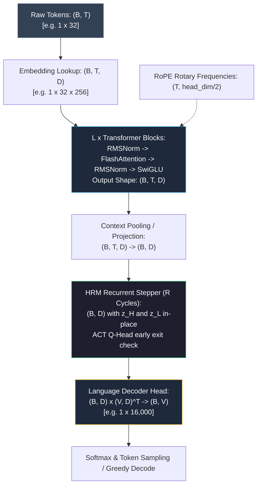

# 🌊 Tensor Flow & Data Pipelines

> [!NOTE] Historical
> This is a **research brief from 2026-09-26 for a model that was never built.** There is no
> embedding table, no $L$ transformer blocks, no RoPE, no FlashAttention, no SwiGLU, no decoder
> head and no $(B, T) \to (B, D) \to (B, V)$ pipeline anywhere in `hrm/`, `hrm_eqb/` or `hrm_x/`.
> The corresponding C++ kernels were never written either. Kept as a record of the shape algebra
> that was planned; the diagrams are worth reading only as a statement of intent.

> [!IMPORTANT] The data path that actually exists
> There are no token sequences and no logits. The real path is **situation + operator + question**:
>
> | Stage | Module | What it produces |
> | :--- | :--- | :--- |
> | Represent the situation | `hrm_x/workspace.py` | an e-graph whose classes are what "follows from" means, with provenance |
> | Know the domain | `hrm_x/domains/{arith,story,grid}.py` | objects, operators, and the data behind them |
> | Know the laws | `hrm_x/rules.py` | rewrite laws proposed by theory exploration, pruned by congruence closure |
> | Infer the operator | `hrm_x/induction.py` | a **posterior over programs**, stored as version spaces, not one winner |
> | Spend compute | `hrm_x/mind.py` | L = saturation, extraction, exact execution; H = value of computation over {propose, derive-group, verify, ask, stop} |
> | Check independently | domain verifiers | residue-phasor replay (arithmetic), dictionary replay + conservation (stories), applicability conditions (grid) |
> | Say it | `hrm_x/writer.py` | the answer, or "I don't know" with the reason |
>
> Exact `Fraction` arithmetic stays in Python; the C++ accelerates only the e-graph and the grid
> (`hrm_x/native/`), and the result is bit-identical to the Python reference by construction of
> the differential test. The only neural component anywhere is the 40,908-parameter
> convention-layer tagger that copies names and numbers by role (ADR-008).

The equations below are kept verbatim as the shape algebra of the abandoned design.

---

## 📐 End-to-End Shape Transformation Pipeline
> [!CAUTION] Never implemented
> No stage of this diagram exists in the codebase. The HRM Recurrent Stepper box refers to a C++
> file that was never written; see [[HRM Recurrent Stepper & ACT]].

---

## 🔢 Step-by-Step Mathematical Formulations
> [!CAUTION] Never implemented
> Sections 1–3 and 5 (embedding, transformer blocks, context pooling, decoder head) have no
> implementation. Section 4's recurrence was built only in the `hrm_eqb/` baseline, in a
> contraction-based form rather than the GRU form written here.

### 1. Tokenization & Embedding
- **Input**: Integer tensor $X \in \mathbb{Z}^{B \times T}$
- **Operation**: Embedding lookup $E = W_E[X]$
- **Output**: $E \in \mathbb{R}^{B \times T \times D}$

### 2. Transformer Backbone Blocks ($l = 1 \dots L$)
- **RMSNorm**:
  $$
  \hat{X} = \frac{X}{\sqrt{\frac{1}{D}\sum_{d=1}^D X_d^2 + \epsilon}} \odot \gamma
  $$
- **Rotary Position Embedding (RoPE)**:
  For each head vector $q \in \mathbb{R}^{\text{head\_dim}}$:
  $$
  \begin{bmatrix} q_{2i}' \\ q_{2i+1}' \end{bmatrix} = \begin{bmatrix} \cos(t\theta_i) & -\sin(t\theta_i) \\ \sin(t\theta_i) & \cos(t\theta_i) \end{bmatrix} \begin{bmatrix} q_{2i} \\ q_{2i+1} \end{bmatrix}
  $$
- **FlashAttention**:
  $$
  O = \text{softmax}\left(\frac{Q K^T}{\sqrt{d_k}} + M_{\text{causal}}\right) V
  $$
- **SwiGLU Feed-Forward Network**:
  $$
  \text{FFN}(x) = \left( (x W_{\text{gate}}) \odot \sigma(x W_{\text{gate}}) \right) (x W_{\text{up}}) W_{\text{down}}
  $$

### 3. Context Pooling to HRM State
- **Operation**: Average pooling across sequence dimension $T$ (or take final prompt token):
  $$
  z_{H0} = \frac{1}{T} \sum_{t=1}^T H_t \in \mathbb{R}^{B \times D}
  $$
- Low-level state initialized as: $z_{L0} = z_{H0}$.

### 4. Hierarchical Reasoning Iterations ($r = 1 \dots R$)
- Injection: $\text{inj} = z_{H, r-1} + z_{H0}$
- Low-level steps: $z_{L} \leftarrow \text{GRU}_{\text{low}}(\text{inj}, z_L)$ repeated $L_{\text{sub}}$ times.
- High-level update: $z_{H} \leftarrow \text{GRU}_{\text{high}}(z_L, z_H)$.
- ACT check: If $p_{\text{halt}} \ge \tau$, break immediately.

### 5. Decoder Head & Logits
- Logits computation:
  $$
  \text{logits} = z_{H, \text{final}} W_{\text{head}}^T \in \mathbb{R}^{B \times V}
  $$

---

## 🔗 Related Notes
- [[HRM+LLM Fusion Architecture]] — System design and model topologies. *(never implemented)*
- [[Kernel Specifications]] — How each kernel was to be implemented in C++. *(never implemented)*
- [[Model Blueprint & Graph Layout]] — Python layer representations of these shapes. *(never implemented)*
- [[HRM-X Workspace & Rules]] — **the data path that exists** (e-graph, laws, inferred programs).
