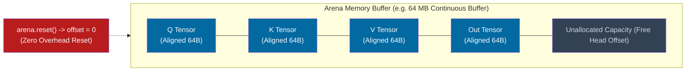

# ⚡ Engine Architecture & Memory Model

> [!WARNING] Not implemented as described
> This note describes the ADR-001 C++/Python hybrid engine, which was **never built**; ADR-003 moved it to `legacy/`. The live C++ is only `hrm_x/native/` (`egraph.cpp`, `grid.cpp`) behind the `hrmx.h` C ABI. The current model is [[HRM-X Specification v0.4 - Operator Inference over Structured Situations]] (ADR-008), in `hrm_x/`. Kept as design history.

Everything below is a **design proposal from 2026-09-26, not a description of code**. The
rationale (allocate nothing in the forward pass, keep the arena cache-line aligned) was sound
for a tensor engine; it was overtaken when the model changed shape. It is kept because the
reasoning is still useful, and because a later design could revisit it.

---

## 🧾 What exists instead (verified 2026-09-28)

| Claim below | Reality in the repo |
| :--- | :--- |
| `ArenaAllocator` bump arena | **No such class.** The native sources contain no arena, no `alignas`, no allocator abstraction; they use ordinary C++ containers. There is no inference-time memory pool, because the hot paths are pointer-chasing symbolic code, not tensor math (spec v0.4 §23). |
| `Tensor` / `TensorView` | **No such class.** Arrays cross the ABI as raw `const int32_t*` / `int32_t*` pointers into caller-owned NumPy buffers; `hrm_x/native/__init__.py` holds the ctypes signatures. |
| `ThreadPool`, `parallel_for` | **None.** `hrm_x/native/src/*.cpp` is single-threaded. |
| 64-byte alignment | **Not done by the engine.** Alignment is whatever NumPy gives; the ABI does no alignment work. |
| `include/hrm/core/tensor.hpp`, `include/hrm/runtime/thread_pool.hpp` | **These paths do not exist.** The C++ tree is only `hrm_x/native/include/hrmx.h` + `hrm_x/native/src/{egraph,grid}.cpp`. |

**The design did land once, then was retired.** The arena, the kernels and these headers exist
at `legacy/cpp_engine/` (with a `CMakeLists.txt` and a prebuilt `bin/hrm_engine.dll`). That code
is dead: nothing in `hrm/`, `hrm_eqb/` or `hrm_x/` includes it.

---

## 💾 Memory Model: The Bump Arena Paradigm

Standard deep learning frameworks spend millions of CPU cycles calling OS memory allocators (`malloc`, `cudaMalloc`, `free`), introducing latency spikes, lock contention, and heap fragmentation.

Our engine utilizes an `ArenaAllocator` *(never implemented — see the table above)*:
- **Pre-allocation**: At engine initialization, a single contiguous memory block (e.g. 64MB – 512MB) is requested from the operating system.
- **64-Byte Alignment**: Every tensor allocation inside the arena is aligned to a 64-byte boundary, matching the hardware cache line of modern x86_64 CPUs (AVX2 / AVX-512) and reducing cache line splits.
- **O(1) Bump Allocation**: Allocating memory for an intermediate activation tensor is simply a pointer bump:
  $$
  \text{ptr} = \text{buffer} + \text{offset}, \quad \text{offset} \leftarrow \text{offset} + \text{aligned\_bytes}
  $$
- **Zero-Cost Instant Reset**: Between forward passes, calling `arena.reset()` simply resets `offset = 0`, reclaiming all intermediate activation memory in zero CPU cycles.

---

## 🧱 The Tensor & TensorView Abstractions

Claimed location `include/hrm/core/tensor.hpp` — **this file does not exist**; the classes below were never implemented.

1. **`Tensor`**:
   - Represents an N-dimensional buffer with `Shape`, `Strides`, and `DataType`.
   - Supports both owning mode (allocated via `DefaultAllocator` or `ArenaAllocator`) and non-owning mode (wrapping external NumPy/C pointers).
2. **`TensorView`**:
   - Non-owning sliced view into a parent tensor without copying underlying memory.
3. **Data Types Supported**:
   - `Float32` (standard precision)
   - `Float16` / `BFloat16` (mixed precision inference)
   - `Int32` (token IDs and index buffers)
   - `Int8` (quantized weights)

---

## 🧵 Concurrency & Worker ThreadPool

Claimed location `include/hrm/runtime/thread_pool.hpp` — **this file does not exist and no thread pool was built**; the native backend is single-threaded.
- Features a work-stealing / chunk-dispatching `ThreadPool`.
- The `parallel_for(begin, end, task)` method breaks large batch or head dimensions into discrete chunks, distributing them across available CPU cores.

---

## 🔗 Related Notes
- [[Kernel Specifications]] — Mathematical kernels executing within the arena. *(also never implemented)*
- [[HRM Recurrent Stepper & ACT]] — Recurrent loop memory management. *(also never implemented)*
- [[ADR-002 Zero Allocation Memory Arena]] — Design decision record for arena memory.
- [[HRM-X Native Backend]] — **the C++ that does exist** (e-graph + grid behind `hrmx.h`).
