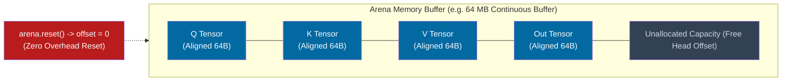

# ⚡ Engine Architecture & Memory Model

The native C++ engine is engineered for **zero runtime allocation overhead** and **maximum cache locality**.

---

## 💾 Memory Model: The Bump Arena Paradigm

Standard deep learning frameworks spend millions of CPU cycles calling OS memory allocators (`malloc`, `cudaMalloc`, `free`), introducing latency spikes, lock contention, and heap fragmentation.

Our engine utilizes an `ArenaAllocator`:
- **Pre-allocation**: At engine initialization, a single contiguous memory block (e.g. 64MB – 512MB) is requested from the operating system.
- **64-Byte Alignment**: Every tensor allocation inside the arena is aligned to a 64-byte boundary, matching the hardware cache line of modern x86_64 CPUs (AVX2 / AVX-512) and reducing cache line splits.
- **O(1) Bump Allocation**: Allocating memory for an intermediate activation tensor is simply a pointer bump:
  $$
  \text{ptr} = \text{buffer} + \text{offset}, \quad \text{offset} \leftarrow \text{offset} + \text{aligned\_bytes}
  $$
- **Zero-Cost Instant Reset**: Between forward passes, calling `arena.reset()` simply resets `offset = 0`, reclaiming all intermediate activation memory in zero CPU cycles.

---

## 🧱 The Tensor & TensorView Abstractions

Located in `include/hrm/core/tensor.hpp`:

1. **`Tensor`**:
   - Represents an N-dimensional buffer with `Shape`, `Strides`, and `DataType`.
   - Supports both owning mode (allocated via `DefaultAllocator` or `ArenaAllocator`) and non-owning mode (wrapping external NumPy/C pointers).
2. **`TensorView`**:
   - Non-owning sliced view into a parent tensor without copying underlying memory.
3. **Data Types Supported**:
   - `Float32` (standard precision)
   - `Float16` / `BFloat16` (mixed precision inference)
   - `Int32` (token IDs and index buffers)
   - `Int8` (quantized weights)

---

## 🧵 Concurrency & Worker ThreadPool

Located in `include/hrm/runtime/thread_pool.hpp`:
- Features a work-stealing / chunk-dispatching `ThreadPool`.
- The `parallel_for(begin, end, task)` method breaks large batch or head dimensions into discrete chunks, distributing them across available CPU cores.

---

## 🔗 Related Notes
- [[Kernel Specifications]] — Mathematical kernels executing within the arena.
- [[HRM Recurrent Stepper & ACT]] — Recurrent loop memory management.
- [[ADR-002 Zero Allocation Memory Arena]] — Design decision record for arena memory.
