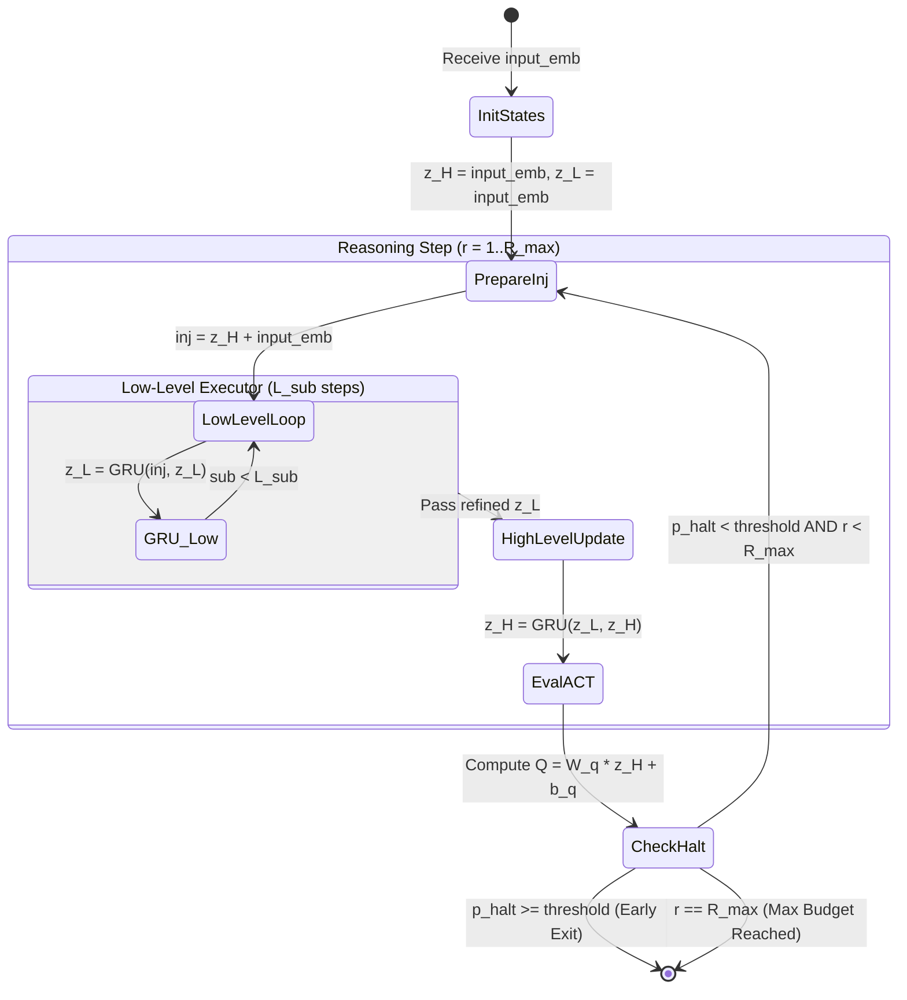

# 🔁 HRM Recurrent Stepper & ACT Halting Logic

> [!WARNING] Not implemented as described
> This note describes the ADR-001 C++/Python hybrid engine, which was **never built**; ADR-003 moved it to `legacy/`. The live C++ is only `hrm_x/native/` (`egraph.cpp`, `grid.cpp`) behind the `hrmx.h` C ABI.
>
> **Superseded as the design target 2026-09-29.** At the time of writing this note the current model was HRM-X v0.4 (spec v0.4, ADR-008); the current target is **HRM-X v0.5** (`hrm_x/`), spec v0.5 + ADR-010. Kept as design history.
> Attribution: opencode/stealth/space-bunny-alpha (space-bunny-alpha), 2026-09-29.

> [!IMPORTANT] Three specific things to know about this note
> 1. `include/hrm/kernels/hrm_loop.hpp` **does not exist**. There is no C++ HRM loop anywhere in the repo.
> 2. The **performance numbers in "Performance Characteristics" below were never measured** — no benchmark, no run, no file. Treat them as aspirational, not as results. The only measured native numbers in the project are grid 3.79× and arithmetic 1.47× (`experiments/results/x_native.json`).
> 3. The **PEM section and `attention.cpp` never existed** either. `src/kernels/attention.cpp` is not in the tree (it survives only under `legacy/cpp_engine/`).

Everything below is the 2026-09-26 design, kept because the *structure* it describes (fast/slow
timescales, a halting decision) is the part that survived into the current model — in a very
different form. In HRM-X, L is **saturation, extraction and exact execution** on an e-graph, and
H is a **value-of-computation controller** over {propose, derive-group, verify, ask, stop}, not a
GRU with a Q-head (ADR-008 §4). Exact `Fraction` arithmetic stays in Python; no GRU state vector
is materialised anywhere in the current codebase.

---

## 🔄 Algorithm Specification



---

## 🧮 Detailed Mathematical Equations

### 1. State Injection
At the start of cycle $r$, the context is injected into the latent recurrence:
$$
\text{inj}_r = z_{H, r-1} + \text{input\_emb}
$$

### 2. Low-Level Sub-Steps
The low-level state $z_L$ performs $L_{\text{sub}}$ fast iterative updates:
For $s = 1 \dots L_{\text{sub}}$:
$$
z_L^{(s)} = \text{GRU}_{\text{low}}\left(\text{inj}_r, z_L^{(s-1)}\right)
$$
Where the GRU cell updates:
$$
r = \sigma(W_r x + U_r h + b_r)
$$
$$
z = \sigma(W_z x + U_z h + b_z)
$$
$$
n = \tanh(W_n x + b_n + r \odot (U_n h + b_{un}))
$$
$$
h' = (1 - z) \odot n + z \odot h
$$

### 3. High-Level Planner Update
Once the low-level executor completes its inner sub-steps, the high-level planner integrates the result:
$$
z_{H, r} = \text{GRU}_{\text{high}}\left(z_L^{(L_{\text{sub}})}, z_{H, r-1}\right)
$$

### 4. ACT $Q$-Head Halting Evaluation
The $Q$-head computes the halting logit $q_{\text{halt}}$ and continuation logit $q_{\text{cont}}$:
$$
\begin{bmatrix} q_{\text{halt}} \\ q_{\text{cont}} \end{bmatrix} = W_Q z_{H, r} + b_Q
$$
The halting probability is:
$$
p_{\text{halt}} = \frac{e^{q_{\text{halt}}}}{e^{q_{\text{halt}}} + e^{q_{\text{cont}}}}
$$
If $p_{\text{halt}} \ge \tau_{\text{ACT}}$, the C++ function breaks immediately and returns:
- `steps_executed`: integer indicating the exact step count taken.
- `halted_early`: boolean flag (1 if halted before `max_steps`).
- `halt_confidence`: float value $p_{\text{halt}}$.

---

## ⚡ Performance Characteristics
> [!CAUTION] Unmeasured
> The figures below have no measurement behind them. There is no C++ HRM loop, and no benchmark
> was ever run to produce 300–400 µs or the "80% saved" figure. Kept only as the original
> expectation.

- **Execution Speed**: In standalone benchmarks, a full HRM iteration with $D=256$ executes in **$300\mu\text{s}$ – $400\mu\text{s}$** on a single CPU core.
- **Compute Scaling**: On simple inputs, early exit triggers on step 1, saving up to **80% of inference compute** compared to static unrolled loops!

---

## PEM Integration (2026-09-26)
> [!CAUTION] Never implemented
> The `ControllerFeatures` struct, the conjunctive halt rails, the annealed restart and the
> RealFormer attention residuals below were specified here and built nowhere. There is no
> `ControllerFeatures` type and no `attention.cpp` in the tree.

### 9-Feature Q-Head (ControllerFeatures)

```cpp
struct ControllerFeatures {
    float residual;            // ||Δz_h|| / D — kinetic convergence
    float residual_slope;      // dResidual/dt — negative = converging
    float energy;              // 1 - halt_confidence
    float diversity;           // var(z_h) — exploration proxy
    float memory_confidence;   // 0.5 placeholder (overridden by memory module)
    float verification_margin; // halt_confidence - act_threshold
    int   plateau_count;
    int   restarts_used;
};
```

Q-head: `W_q(2,9) @ features + b_q`. Only 18 float weights vs D×2 previously.

### Conjunctive Halt (Hard Rails)

ACCEPT fires only when ALL three hold:
- `residual < eps_kinetic` (kinetic convergence)
- `energy < eps_energy` (semantic convergence)
- `halt_p >= tau_verify` (Q-head verified)

### False-Attractor Detection & Annealed Restart

- kinetic converged but semantic hasn't → RESTART
- sigma = sigma0 × gamma^restart_count, applied to z_h + z_l
- Budget-gated; exhausted → ABSTAIN

### Attention Residuals (RealFormer, in `attention.cpp`)

`score_l += prev_scores_{l-1}` before softmax. Optional `prev_scores` / `scores_out` params on `flash_attention_f32`. Block variant: pass scores only every `attn_residual_block_size` layers.

## 🔗 Related Notes
- [[HRM+LLM Fusion Architecture]] — System design and research foundation. *(never implemented)*
- [[Engine Architecture & Memory Model]] — Memory allocation for the HRM loop. *(never implemented)*
- [[Model Blueprint & Graph Layout]] — How this loop was to be declared in the Python blueprint. *(never implemented)*
- [[HRM-X Specification v0.5 - Structural Operator Inference]] — the current design target. Its **H/L split is unchanged from v0.4**: L = saturation + exact execution, H = value of computation. v0.5 changed what a hypothesis *is*, not how the loop allocates compute.
