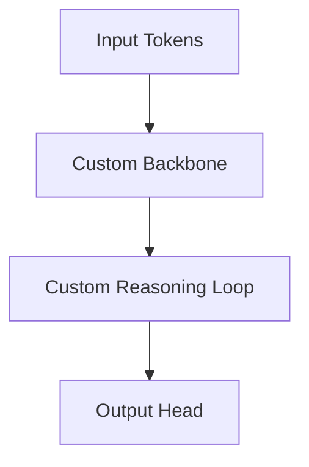

# 🐍 Blueprint Proposal: {{ModelBlueprintName}}

## Architecture Overview
High-level description of the proposed model layout, layer connectivity, and reasoning mechanism.

## Topology Diagram


## Layer Specifications
| Layer Name | Op Type | Input Shape | Output Shape | Parameters |
| :--- | :--- | :--- | :--- | :--- |
| `token_emb` | `embedding` | `(B, T)` | `(B, T, D)` | $V \times D$ |
| `...` | `...` | `...` | `...` | `...` |

## Hyperparameter Profiles
```yaml
model_name: "{{ModelBlueprintName}}"
vocab_size: 32000
hidden_dim: 512
...
```

## Experimental Hypotheses
1. *Hypothesis 1*: ...
2. *Hypothesis 2*: ...
