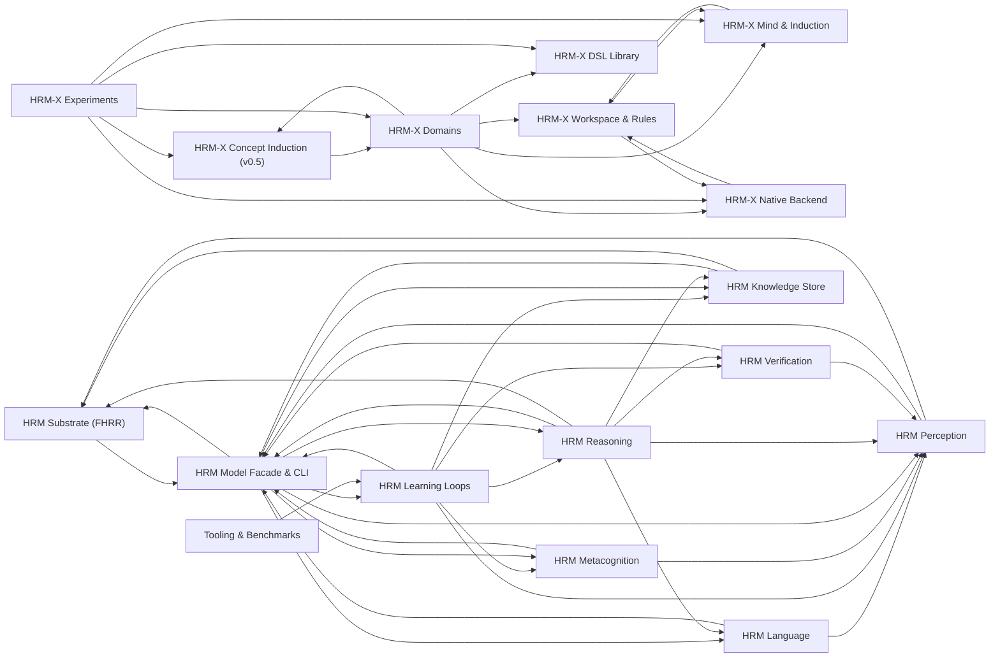

# Code Subsystems

Generated by `scripts/knowledge_map.py` (run by `scripts/update_knowledge_graph.ps1`).
One note per subsystem; functions are deliberately absent. For symbol-level impact
queries use `graphify query` on `graphify-out/graph.json`. Hand-written companion: [[Code Map]].

## `hrm_x/` — HRM-X v0.5, the current model (structural operator inference)

- [[HRM-X Workspace & Rules]] — E-graph with provenance: congruence closure, conflicts with blame, rule saturation, extraction.
- [[HRM-X Mind & Induction]] — Operator hypotheses as programs, law discovery, the VOC controller, modulators, trace writer.
- [[HRM-X DSL Library]] — Structural MDL primitive mining, exact abstraction/expansion, and the measured credit a library earns in search.
- [[HRM-X Concept Induction (v0.5)]] — Law-closed hypothesis families fitted exactly over Q, the determinacy test of Theorem 3, the open-world coverage rule and BOTTOM, corpus-MDL consolidation, phasor binding, and the group-theoretic grid and place-value layers.
- [[HRM-X Domains]] — Arithmetic concepts, word-problem stories, grid object programs; their verifiers.
- [[HRM-X Native Backend]] — C++ e-graph and grid kernels behind a C ABI, parity-tested against the Python reference.
- [[HRM-X Experiments]] — E1-E12 runners with baselines and ablations; results recorded as JSON.

## `hrm_eqb/` — HRM-EQB baseline (neural, certified)

## `hrm/` — program-search baseline

- [[HRM Substrate (FHRR)]] — Phasor algebra, name-derived codebook, backend validation gate.
- [[HRM Perception]] — Domain protocol; grid, sequence and 3-D domains; the program language.
- [[HRM Reasoning]] — Fast path, H-equilibrium, synthesis search, halting and restarts.
- [[HRM Verification]] — Independent judge: exact replay, determinism, anti-memorization.
- [[HRM Knowledge Store]] — SSD store: memmap fp16 keys plus a sqlite journal.
- [[HRM Language]] — Language section backends, inner speech, text notation.
- [[HRM Metacognition]] — Self-model (competence), curiosity, intent regression.
- [[HRM Learning Loops]] — Online learner, generators, frozen harness, sleep cycle, self-study.
- [[HRM Model Facade & CLI]] — Bundle directory, core weights, config, traces and the CLI.

## Tooling

- [[Tooling & Benchmarks]] — Benchmark fetch and generation, graph and code-map tooling.

## Dependencies

## What each session changed

| session | subsystems |
|---|---|
| [[Session - 2026-09-26 - Foundation & Research]] | Tooling & Benchmarks |
| [[Session - 2026-09-27 - Benchmark v2 and the Reasoning Ceiling]] | HRM Learning Loops, HRM Perception, HRM Reasoning, HRM Verification, Tooling & Benchmarks |
| [[Session - 2026-09-27 - Graph Rebuild and Benchmarks]] | Tooling & Benchmarks |
| [[Session - 2026-09-27 - HRM-EQB Full Build]] | Tooling & Benchmarks |
| [[Session - 2026-09-27 - Understanding by Construction]] | Tooling & Benchmarks |
| [[Session - 2026-09-27 - Unified Model Build]] | HRM Knowledge Store, HRM Language, HRM Learning Loops, HRM Metacognition, HRM Model Facade & CLI, HRM Perception, HRM Reasoning, HRM Substrate (FHRR), HRM Verification |
| [[Session - 2026-09-28 - DSL Growth, Free Text, and the Graph Pipeline]] | HRM-X DSL Library, HRM-X Domains, HRM-X Experiments, HRM-X Mind & Induction, Tooling & Benchmarks |
| [[Session - 2026-09-28 - HRM-X v0.4 PoC and Native Backend]] | HRM-X Domains, HRM-X Experiments, HRM-X Mind & Induction, HRM-X Native Backend, HRM-X Workspace & Rules, Tooling & Benchmarks |
| [[Session - 2026-09-29 - EQB and HRM-X Audit]] | EQB Task Field & Generators, EQB Training, Study & Bench, HRM-X Concept Induction (v0.5), HRM-X Domains, HRM-X Experiments, HRM-X Mind & Induction |
| [[Session - 2026-09-29 - HRM-X v0.5 Structural Induction and Vault Cleanup]] | HRM-X Concept Induction (v0.5), HRM-X DSL Library, HRM-X Domains, HRM-X Experiments, HRM-X Mind & Induction, Tooling & Benchmarks |
