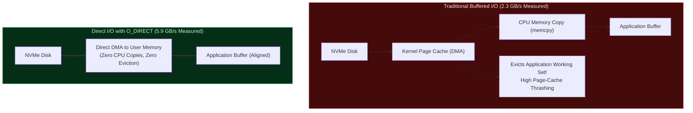

# 🚀 Concept: Direct I/O (O_DIRECT) & NVMe Streaming

**Direct I/O (`O_DIRECT`)** is an operating system flag that instructs the filesystem to bypass the OS page cache entirely, reading data directly from storage media into user-space application memory buffers.

In `kimi-k3-in-c`, Direct I/O is the core mechanism that **turns a 113.5 GB memory floor into a flexible dial**.

---

## 🏎️ Why O_DIRECT Beats the Operating System Buffer Cache

Conventional wisdom assumes reading through the OS page cache is faster because cached pages can be reused. In multi-gigabyte neural network streaming, **that assumption is completely inverted**:



### 1. Zero Page Cache Eviction Thrashing
When streaming a 109 GB dense trunk or 1.45 TB of experts through buffered I/O, the kernel fills all available physical RAM with cached disk pages, aggressively evicting the model's actual working set (active KV caches, state matrices, and thread stacks).

### 2. Eliminating the Kernel-to-User `memcpy`
With `O_DIRECT`, the NVMe storage controller writes data directly into the application's pre-allocated memory buffer via Direct Memory Access (DMA), eliminating CPU memory copies and doubling effective throughput ($2.3\text{ GB/s} \to 5.9\text{ GB/s}$).

---

## 📏 Alignment Contracts & The Portable I/O Shim

Direct I/O enforces strict hardware sector alignment:
1. **Memory Buffer Pointer**: Must be aligned to a multiple of the sector size (typically 512 bytes or 4096 bytes).
2. **File Read Offset**: Must start at a sector boundary.
3. **Read Length**: Must be a multiple of the sector size.

### Window Widening Algorithm (`k3_st_read_aligned`)
Because individual tensors in a `.safetensors` file start at arbitrary byte offsets, the reader widens requests outward to the enclosing sector-aligned window:
```c
// Widen outward to enclosing 512-byte aligned boundaries
int64_t lo = off & ~(int64_t)(ALIGN - 1);
int64_t hi = (off + nbytes + ALIGN - 1) & ~(int64_t)(ALIGN - 1);
int64_t pad = off - lo;

// Read aligned block directly from NVMe
pread(dfd, buf, hi - lo, lo);

// Return pointer offset by padding
return (char*)buf + pad;
```

---

## 🎛️ Turning a Memory Floor into a Dial

By packing the 93 dense trunk layers into a single contiguous file (`trunk.bin`), the engine allows the user to allocate whatever memory they possess:
- **Pinned Layers Prefix**: If you have 32 GB, pin the first 24 layers in RAM permanently; stream the remaining 69 layers through a 2-slot circular ring buffer.
- **Full Resident Server**: If you have 128 GB, pin all 93 layers permanently.

The exact same binary executes either path with **zero code modifications**!

---

## 🔗 Related Knowledge Graph Nodes
- [[Concept - The Four Memory Reductions]] — Fourth level of memory reduction.
- [[Concept - Microscaling MXFP4 & E8M0 Quantization]] — Streaming quantized weights.
- [[Engine Architecture & Memory Model]] — Memory arena hosting Direct I/O buffers.
