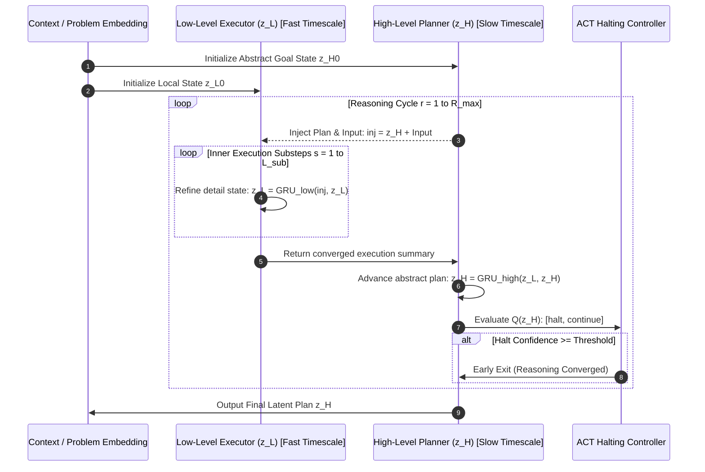

# 🧠 Concept: Hierarchical Multi-Timescale Reasoning (HRM)

The **Hierarchical Reasoning Model (HRM)** (Wang et al., 2025; sapientinc/HRM) is a neural architecture engineered for deep, multi-step algorithmic reasoning (such as ARC puzzles, Sudoku, chess, and mathematical theorem proving).

Unlike standard LLMs that rely on verbose token generation (Chain-of-Thought), HRM performs **explicit iterative computation in continuous latent space** via a nested multi-timescale recurrence loop.

---

## 🏛️ The Multi-Timescale Philosophy

Biological cognitive systems process information at multiple temporal resolutions:
- **Fast timescale**: Detailed, immediate motor/sensory execution and local consistency checks.
- **Slow timescale**: Strategic, abstract goal decomposition and long-range planning.

Standard single-pass Transformer feedforward layers force every layer to operate at the same homogeneous depth. HRM explicitly separates these timescales into two interdependent recurrent modules:

---

## ⚡ Why Architectural Recurrence Beats Prompted CoT Alone

| Evaluation Vector | Chain-of-Thought (CoT) Prompting | HRM Latent Recurrence |
| :--- | :--- | :--- |
| **Compute Location** | Autoregressive token generation | Hidden latent recurrence |
| **Token Overhead** | Hundreds of verbose reasoning tokens | **Zero extra tokens** (direct solution output) |
| **Backpropagation** | Discontinuous (sampled token space) | Differentiable end-to-end through final step |
| **Error Propagation** | Early token errors derail the entire chain | State error-corrects across iterations |
| **Parameter Efficiency** | Requires 70B+ parameters to emerge | Outperforms large LLMs on ARC with **27M parameters** |

---

## 🛡️ Training Dynamics: Truncated Gradient Stabilization

Recurrent backpropagation across many unrolled steps causes exploding or vanishing gradients. HRM addresses this through a **truncated no-grad regime**:
- Steps $1$ through $R-1$ execute under `torch.no_grad()` or detached C++ execution.
- Only the final reasoning step $R$ carries gradient backpropagation into the model weights.
- This stabilizes recurrent dynamics and reduces memory footprint by over **85%** during training.

---

## 🔗 Related Knowledge Graph Nodes
- [[Concept - Adaptive Computation Time (ACT)]] — How the HRM loop decides to stop.
- [[HRM+LLM Fusion Architecture]] — System integration with Transformer backbone.
- [[HRM Recurrent Stepper & ACT]] — Bare-metal C++ kernel implementation.
- [[Semantic Relationship Matrix]] — Ontological links.
