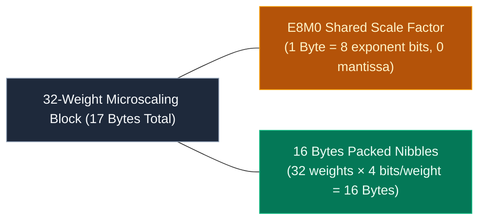

# 🔬 Concept: Microscaling MXFP4 & E8M0 Quantization

**Microscaling MXFP4** (OCP Microscaling Format) is an ultra-compact floating-point quantization format used to ship massive deep learning weights.

In Kimi K3, all **82,432 routed experts** are pre-quantized in MXFP4 format, enabling them to be stored at **0.53125 bytes per parameter**.

---

## 🧩 Anatomy of the MXFP4 Block

Standard INT4/FP4 quantization requires storing a scale factor for every group of weights (e.g., group size 32 or 64). MXFP4 standardizes this via **microscaled blocks**:

### 1. Per-Weight 4-Bit Nibbles
- Each 4-bit nibble represents an FP4 value (sign bit, exponent, mantissa: usually E2M1 format).
- Two weights are packed into each physical byte:
  $$
  \text{byte} = (\text{weight}_1 \ \&\ \text{0x0F}) \mid ((\text{weight}_2 \ \&\ \text{0x0F}) \ll 4)
  $$

### 2. The E8M0 Shared Scale
- A single 8-bit scale factor is shared across every block of 32 weights.
- E8M0 uses 8 bits of pure power-of-two exponent (no mantissa bits), allowing multiplication by $2^{\text{exp} - 127}$ with simple bit-shift or exponent addition:
  $$
  \text{Scale Overhead} = \frac{1 \text{ Byte}}{32 \text{ weights}} = 0.03125 \text{ Bytes per weight}
  $$

### 3. Total Storage Arithmetic
$$
\text{Total Bytes per Parameter} = 0.5 \text{ (nibble)} + 0.03125 \text{ (E8M0 scale)} = \mathbf{0.53125 \text{ Bytes}}
$$
For an expert of $33,030,144$ parameters:
$$
33,030,144 \times 0.53125 = \mathbf{17,547,264 \text{ Bytes exactly}}
$$

---

## ⚡ Direct On-the-Fly Unpack Matmul

The C++ engine does not decompress all 1.45 TB of experts into memory before multiplying. Instead, the matrix multiplication kernel:
1. Streams the packed 4-bit nibbles and E8M0 scale directly from the NVMe buffer.
2. Unpacks the nibbles into 8-wide AVX2 registers on-the-fly using bitwise `vpand` and `vpsrlw`.
3. Multiplies by the input activation vector in L1 cache.
4. Intermediate memory footprint = **0 MB**!

---

## ❓ Why the Dense Trunk is NOT Quantized

As explained in `kimi-k3-in-c`:
- **The Dense Trunk** ($108.81\text{ GB}$) is kept in uncompressed **BF16**.
- The trunk carries global representations, token embeddings, norms, and attention projections across all 93 layers.
- Quantizing the trunk would degrade linguistic coherence across long conversations, whereas the sparse MoE experts have sufficient parameter redundancy to absorb 4-bit quantization with zero loss in benchmarks.

---

## 🔗 Related Knowledge Graph Nodes
- [[Concept - Block Sparse Mixture of Experts (MoE)]] — Where MXFP4 weights are utilized.
- [[Concept - The Four Memory Reductions]] — First level of the reduction cascade.
- [[Concept - Direct IO & NVMe Streaming]] — Streaming MXFP4 blocks from disk.
