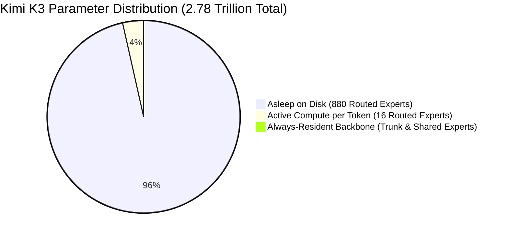

# 🔀 Concept: Block Sparse Mixture of Experts (MoE)

**Block Sparse Mixture of Experts (MoE)** is the architectural technique that enables scaling neural networks to trillions of parameters while keeping per-token compute and active working set memory bounded.

In Kimi K3, **92 of the 93 layers** utilize Block Sparse MoE (Layer 0 is dense feed-forward).

---

## 📊 Scale & Sparsity Census

- **Total Experts per Layer**: 896 routed experts.
- **Active Experts per Token**: Top-16 experts selected dynamically.
- **Shared Experts**: 2 shared experts that execute unconditionally on every token (always resident in RAM).
- **Total Routed Experts across Model**:
  $$
  92 \text{ MoE layers} \times 896 \text{ experts} = 82,432 \text{ routed experts}
  $$
- **Active Parameter Fraction**:
  $$
  \frac{16 \text{ active}}{896 \text{ total}} \approx 1.78\% \text{ of routed experts active per token}
  $$
  Including shared experts and dense trunk, only **104 billion parameters** are active out of **2.78 trillion** ($\approx 3.7\%$). The remaining **$96.3\%$ of the model sleeps on disk**!

---

## 🧮 Routing Mechanics & The Routing Bias Invariant

The router calculates routing logits $s \in \mathbb{R}^{896}$ from token hidden state $x$:
$$
s_i = W_{\text{gate}, i} \cdot x + b_{\text{bias}, i}
$$

### The Unbiased Combination Invariant (Invariant 3)
As proven in `kimi-k3-in-c`:
> *The MoE routing bias steers selection only. The combining weights come from the unbiased sigmoid scores.*

1. **Selection Phase (Top-K with Bias)**:
   The router picks the top 16 expert indices based on biased logits:
   $$
   \mathcal{T} = \text{TopK}_{16}(s_i)
   $$
2. **Combination Phase (Unbiased Softmax/Sigmoid)**:
   The actual weighting coefficients $\alpha_i$ applied to the outputs of the 16 selected experts are computed **without** the router bias:
   $$
   \tilde{s}_i = W_{\text{gate}, i} \cdot x \quad (\text{no bias added})
   $$
   $$
   \alpha_i = \frac{e^{\tilde{s}_i}}{\sum_{j \in \mathcal{T}} e^{\tilde{s}_j}}
   $$
   Using the biased scores to weigh the outputs quietly corrupts the representational space and degrades fluency.

---

## 💾 Storage & Memory Footprint

Every routed expert occupies exactly:
$$
\text{Params per expert} = 33,030,144
$$
Stored in packed 4-bit representation (MXFP4 with E8M0 scale):
$$
\text{Bytes per expert} = 33,030,144 \times 0.53125 \text{ B} = 17,547,264 \text{ Bytes} \approx 16.73 \text{ MB}
$$
Together, all 82,432 routed experts equal **1.447 terabytes**, accounting for **93% of the entire 1.56 TB checkpoint**! Because only 16 experts per layer fire, they are streamed on-demand via an LRU cache or direct NVMe reads rather than loaded into RAM.

---

## 🔗 Related Knowledge Graph Nodes
- [[Concept - The Four Memory Reductions]] — How MoE sparsity reduces active RAM.
- [[Concept - Microscaling MXFP4 & E8M0 Quantization]] — The 0.53125 byte/param encoding.
- [[Concept - Direct IO & NVMe Streaming]] — Streaming the 82,432 experts from disk.
- [[00 - External Research Index]] — the rest of the Kimi K3 study, and why it is external.
