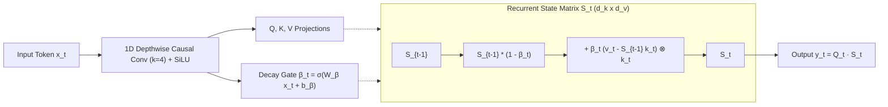

# 🔁 Concept: Kimi Delta Attention (KDA)

**Kimi Delta Attention (KDA)** is a constant-memory recurrent linear attention mechanism introduced in Moonshot AI's **Kimi K3** (2.78-trillion parameter architecture) and analyzed in Fareed Khan's `kimi-k3-in-c`.

In Kimi K3, KDA powers **69 of the 93 total model layers**, ensuring that the memory required to maintain conversation state remains strictly $O(1)$ rather than growing with sequence length.

---

## 🎯 The Problem KDA Solves

Standard Softmax Attention requires storing the Key and Value vectors for every historical token in a Key-Value (KV) cache:
$$
\text{Memory}_{\text{KV}} = 2 \times B \times L \times H \times T \times d_{\text{head}}
$$
As sequence length $T$ extends (e.g., to 32K or 128K tokens), the KV cache expands into hundreds of gigabytes, exhausting VRAM/RAM regardless of model weights.

KDA replaces the token-by-token KV history with a **fixed-size recurrent hidden state matrix** $S_t \in \mathbb{R}^{d_k \times d_v}$ per head, meaning memory consumption at token 100,000 is **byte-for-byte identical** to token 1.

---

## 📐 Mathematical Formulation of the Delta Rule

KDA processes tokens sequentially (or in chunked parallel form) via an input-dependent delta update:

### 1. Depthwise Causal Convolution
Before projection, inputs pass through a short 1D causal depthwise convolution with kernel size $k=4$, followed by a fused SiLU non-linearity:
$$
u_t = \text{SiLU}\left(\text{Conv1D}_{k=4}(x_{t-3:t})\right)
$$

### 2. Bounded State Decay Gating
KDA learns an input-dependent decay parameter $\beta_t \in (0, 1)$ bounded by a lower bound $\text{gate\_lb} = -5.0$:
$$
g_t = \max(W_g u_t + b_g, -5.0), \quad \beta_t = \sigma(g_t)
$$

### 3. The Delta Update Rule
The state matrix $S \in \mathbb{R}^{d_k \times d_v}$ is updated by error-correcting against the current key-value pair:
$$
e_t = v_t - S_{t-1} k_t
$$
$$
S_t = S_{t-1} + \beta_t (e_t \otimes k_t)
$$
Where:
- $S_{t-1} k_t$ represents the model's prediction of value $v_t$ from the existing memory.
- $e_t$ is the residual error (what the existing state failed to represent).
- The state only changes when new information arrives that is not already captured!

### 4. Attention Readout
The output token representation is computed by querying the state matrix directly:
$$
y_t = q_t S_t
$$

---

## ⚡ Architectural Properties in Kimi K3

- **Number of Layers**: 69 of 93 layers.
- **Head Geometry**: 96 heads, $d_k = d_v = 128$.
- **Per-Layer State Size**:
  $$
  96 \text{ heads} \times (128 \times 128) \text{ floats} \times 4 \text{ bytes} = 6.29 \text{ MB per layer}
  $$
  Across all 69 KDA layers, the entire recurrent memory footprint is **434 MB total**, completely independent of prompt length!

---

## 🔗 Related Knowledge Graph Nodes
- [[Concept - Multi-Head Latent Attention (MLA)]] — Global attention mechanism alternating with KDA.
- [[Concept - The Four Memory Reductions]] — How KDA contributes to the 675× memory cascade.
- [[Concept - Block Sparse Mixture of Experts (MoE)]] — Feed-forward layers paired with KDA.
- [[00 - External Research Index]] — the rest of the Kimi K3 study, and why it is external.
