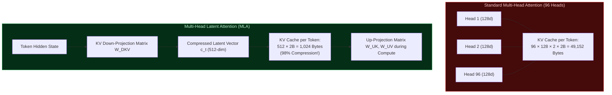

# 🎯 Concept: Multi-Head Latent Attention (MLA)

**Multi-Head Latent Attention (MLA)** is an attention architecture introduced in DeepSeek-V2/V3 and Kimi K3 designed to resolve the memory bandwidth bottleneck during autoregressive decoding.

In Kimi K3, MLA is utilized in **24 of the 93 total layers** (specifically layers 4, 8, 12, ..., 88, 92, and 93), serving as periodic global attention checkpoints between KDA layers.

---

## 🔍 The KV Cache Memory Bandwidth Problem

In standard Multi-Head Attention (MHA), generation speed is strictly bounded by memory bandwidth: the GPU or CPU must stream every prior token's Key and Value vectors from memory into caches for every single generated token. Grouped-Query Attention (GQA) reduces this by grouping heads, but sacrifices expressive representational capacity.

MLA solves this by projecting Key and Value heads into a **low-rank compressed latent space**:
Instead of caching $H=96$ independent key and value heads, MLA caches only a **single compact latent vector** $c_t^{\text{KV}} \in \mathbb{R}^{d_c}$ where $d_c = 512$.

---

## 📐 Mathematical Formulation of MLA

### 1. Latent Key-Value Compression
For input vector $x_t \in \mathbb{R}^D$:
$$
c_t^{\text{KV}} = W_{\text{DKV}} x_t, \quad c_t^{\text{KV}} \in \mathbb{R}^{d_c} \quad (d_c = 512)
$$
During generation, **only $c_t^{\text{KV}}$ is appended to the KV cache**, shrinking cache storage and memory bandwidth by **over 95%**!

### 2. On-the-Fly Projection to Head Queries and Keys
When computing attention scores:
$$
k_{t, h}^{\text{NoPE}} = W_{\text{UK}, h} c_t^{\text{KV}} \in \mathbb{R}^{d_{\text{NoPE}}} \quad (d_{\text{NoPE}} = 128)
$$
$$
v_{t, h} = W_{\text{UV}, h} c_t^{\text{KV}} \in \mathbb{R}^{d_v} \quad (d_v = 128)
$$

### 3. The NoPE Invariant
As highlighted in `kimi-k3-in-c` Invariant 2:
> *MLA uses NoPE (No Positional Embedding rotation), yet the 64 RoPE dimensions still exist in the weight tensors and are still cached.*
> Only the actual trigonometric rotation is skipped; omitting the 64 slots changes the head width and corrupts the matrix multiplication dimension contract!

---

## ⚡ Why Alternate MLA with KDA?

Kimi K3 alternates between 3 layers of KDA and 1 layer of MLA (with both layers 92 and 93 using MLA):
- **KDA Layers (69 layers)**: Maintain running recurrent memory with zero KV growth ($O(1)$ memory).
- **MLA Layers (24 layers)**: Provide periodic exact global token-to-token attention across the entire prompt context, preventing the loss of needle-in-a-haystack factual recall common to pure linear attention.

---

## 🔗 Related Knowledge Graph Nodes
- [[Concept - Kimi Delta Attention (KDA)]] — Recurrent partner to MLA.
- [[Concept - The Four Memory Reductions]] — Impact on overall RAM constraints.
- [[Concept - Block Sparse Mixture of Experts (MoE)]] — Surrounding feed-forward architecture.
- [[00 - External Research Index]] — the rest of the Kimi K3 study, and why it is external.
