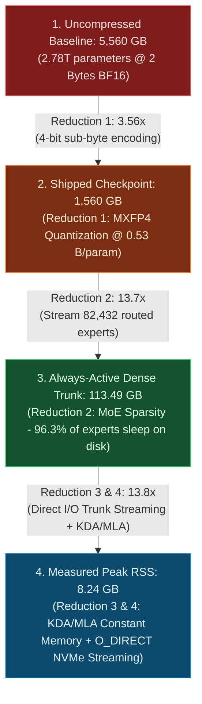

# 📉 Concept: The Four Memory Reductions

The **Four Memory Reductions** represent the architectural cascade formulated in Fareed Khan's `kimi-k3-in-c` that enables running a **2.78-trillion parameter model on an ordinary consumer machine with 8 GB of RAM**.

Crucially, **the output at the bottom of the ladder (8.24 GB) is byte-for-byte identical to the top (5,560 GB)**; no weights are pruned and no approximations are made.

---

## 🪜 The Memory Reduction Cascade

---

## 📊 Detailed Ledger of Reductions

| Level | Footprint | Primary Mechanism | Technical Explanation |
| :--- | :--- | :--- | :--- |
| **0. Naive Baseline** | **5,560 GB** | Full BF16 Storage | $2.78 \times 10^{12} \text{ parameters} \times 2 \text{ bytes/float} = 5.56 \text{ TB}$. Requires a cluster of 8× NVIDIA H100 GPUs ($8 \times 80\text{ GB} = 640\text{ GB}$) simply to load weights. |
| **1. Quantization** | **1,560 GB** | **Reduction 1: MXFP4** | The routed experts arrive at half a byte per weight ($0.5$ bytes per nibble + $1/32$ byte shared E8M0 scale factor = $0.53125$ bytes/param). |
| **2. MoE Sparsity** | **113.49 GB** | **Reduction 2: Routing** | 896 routed experts exist per layer, but only 16 fire per token. The 82,432 routed experts ($1.447\text{ TB}$) never load into RAM. Only the dense trunk ($108.81\text{ GB}$) and embeddings ($4.70\text{ GB}$) are resident. |
| **3. Streamed Trunk & KDA** | **8.24 GB** | **Reduction 3 & 4: Streaming** | The 109 GB dense trunk is packed into contiguous blocks and streamed off NVMe using `O_DIRECT` direct disk reads. KDA maintains $O(1)$ constant recurrent memory. Only a small working set stays resident. |

**Total Reduction Factor**:
$$
\frac{5,560 \text{ GB}}{8.24 \text{ GB}} \approx \mathbf{675\times \text{ Reduction}}
$$

---

## ⚡ The Trade-off: Memory Buys Speed, Never Accuracy

Because the mathematics of the forward pass is preserved bit-for-bit:
- **8 GB Laptop**: Generates output at **$26.5\text{ s/token}$** (entire model streamed from NVMe).
- **32 GB Laptop**: Generates output at **$24.2\text{ s/token}$** (partial trunk resident).
- **64 GB Desktop**: Generates output at **$19.8\text{ s/token}$** (larger expert LRU cache).
- **128 GB+ Workstation**: Generates output at **$5.6\text{ s/token}$** (entire trunk resident, zero disk wait).

Every machine produces the **exact same token sequence**, byte-for-byte!

---

## 🔗 Related Knowledge Graph Nodes
- [[Concept - Block Sparse Mixture of Experts (MoE)]] — Sparsity reduction mechanics.
- [[Concept - Microscaling MXFP4 & E8M0 Quantization]] — Sub-byte weight details.
- [[Concept - Direct IO & NVMe Streaming]] — Kernel disk I/O implementation.
- **Bit-Identical Floating Point Contracts** — guarantees identical output across machines.
  No concept note exists; the idea is discussed in [[ADR-003 Unified Cognitive Model]] as one
  of the reasons the old C++ engine was rejected, and in [[Engine Architecture & Memory Model]].
